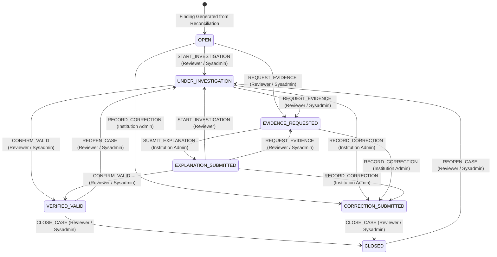
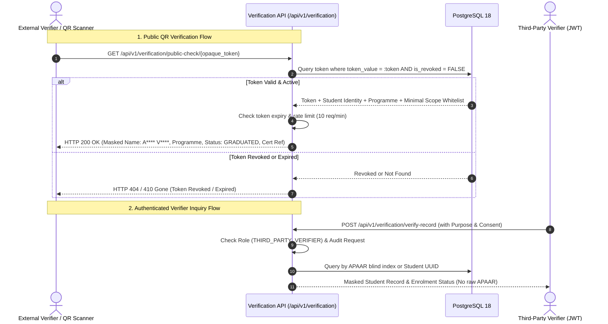
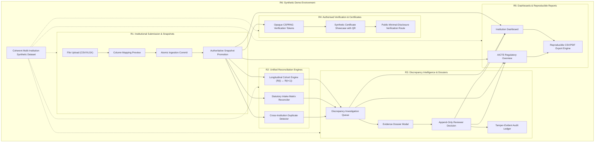

# APAAR SETU — Milestone 5 Comprehensive Requirements & Specification Matrix
**Platform:** APAAR SETU — Longitudinal Student Data Integrity & Verification Platform  
**Problem Statement ID:** AICTE SIH26263  
**Document Author:** Spec Miner (`teamwork_spec_miner`)  
**Target Milestone:** Milestone 5 (Unified Integration of Milestones 1–4)  
**Date:** October 31, 2026  
**Status:** Authoritative Specification & Baseline Survey  

---

## 1. Executive Summary & Objective

The objective of Milestone 5 is to unify, integrate, and demonstrate Milestones 1–4 of the **APAAR SETU** platform into one coherent, demonstrable APAAR ID-based student data management and regulatory verification platform for AICTE-approved institutions and regulatory reviewers.

Rather than building disconnected prototypes, Milestone 5 connects:
1. **Institutional Data Submission & Roster Snapshots (Milestone 3)**
2. **Student Repository, APAAR Identity Validation & Privacy Controls (Milestones 1 & 2)**
3. **Statutory Admission & Approval Matrix Intake Reconciliation (Milestone 4)**
4. **Longitudinal Cohort Integrity Engine & Cross-Institution Trajectory Analysis (Milestone 3 / Signature Innovation)**
5. **Evidence-Backed Discrepancy Investigation & Append-Only Determinations (Phase 3E)**
6. **Authorised Student Record Verification, Opaque Tokens & QR Demonstration (Milestone 5 / R4)**
7. **Institution & AICTE Regulatory Dashboards & Reproducible Reporting (Milestone 5 / R5)**
8. **Multi-Institution Coherent Synthetic Demonstration Dataset (Milestone 5 / R6)**

All features must strictly preserve existing functionality, maintain database consistency on PostgreSQL 18, enforce multi-tenant security and field-level privacy, and avoid automated punitive fraud labeling.

---

## 2. Existing Capability Map (Milestones 1–4)

A comprehensive inspection of the existing codebase (`backend/app/`, `backend/alembic/`, `backend/tests/`, and `src/`) establishes the following current baseline:

| Domain Subsystem | Existing Files / Routes | Current Status & Capabilities |
| :--- | :--- | :--- |
| **Authentication & RBAC** | `backend/app/api/v1/auth.py` `backend/app/core/security.py` `backend/app/core/permissions.py` | **Operational.** Argon2id password hashing, 15-minute JWT tokens, session revocation via `session_revocations` (`jti` table), role guards (`require_roles`). Seeded accounts for 5 roles exist. |
| **Institutions & Programmes** | `backend/app/api/v1/institutions.py` `backend/app/models/institution.py` `backend/app/models/programme.py` | **Operational.** CRUD operations on institutions and programmes. Category support (`ENGINEERING`, `POLYTECHNIC`, `UNIVERSITY`). State, district, and contact metadata. |
| **Student Repository & Identity** | `backend/app/api/v1/students.py` `backend/app/services/identity_service.py` `backend/app/models/student_identity.py` | **Operational.** Strict format validation (12-digit numeric regex, no invented checksums), `MISSING_APAAR` vs `FORMAT_VALID` vs `INVALID_FORMAT`. Dual cryptographic separation: AES-256-GCM ciphertext + HMAC-SHA256 blind index. Roll numbers decoupled from global identity. Student timeline API. |
| **Data Submission Pipeline** | `backend/app/api/v1/submissions.py` `backend/app/services/ingestion_service.py` `backend/app/services/preview_service.py` `backend/app/services/parser_service.py` | **Operational.** Three-phase ingestion architecture: Operation A (Upload, fingerprint, ZIP bombs/XML defused), Operation B (Full mapping preview with `submission_previews` hash binding), Operation C (Atomic transactional confirm with advisory lock & dual-transaction rollback). Raw evidence preserved verbatim. |
| **Snapshot Selection Manager** | `backend/app/api/v1/snapshots.py` `backend/app/services/snapshot_service.py` `backend/app/models/roster_snapshot.py` | **Operational.** Partial unique index `idx_uq_authoritative_snapshot` guaranteeing at most one authoritative snapshot per `(institution, programme, year)`. Decoupled completeness (`COMPLETE`, `PARTIAL`, `UNKNOWN`) from lifecycle (`ACTIVE`, `SUPERSEDED`). Promotion serialized via context advisory lock `snap_{inst}_{prog}_{year}`. Canonical hash `v1-sha256-sorted-uuids` (no plaintext APAAR). |
| **Longitudinal Cohort Engine** | `backend/app/api/v1/reconciliation.py` `backend/app/services/comparison_service.py` `backend/app/services/reconciliation_service.py` | **Operational.** Reconstructs transitions: `CONTINUING`, `ADDED`, `DOCUMENTED_TRANSFER`, `WITHDRAWN`, `UNEXPLAINED_APPEARANCE`, `UNEXPLAINED_DISAPPEARANCE`, `AMBIGUOUS_IDENTITY`, `INSUFFICIENT_EVIDENCE`. Deterministic result fingerprints (`SHA-256`). Automatic baseline resolution. |
| **Regulatory Intake Matrix** | `backend/app/api/v1/approvals.py` `backend/app/services/approval_service.py` `backend/app/services/intake_service.py` `backend/alembic/versions/0005_approval_intake_matrix.py` | **Operational.** Approval configurations versioned by academic year. Category allocations (Sanctioned Intake, Supernumerary, Lateral Entry, Management Quota). Deterministic rounding (`FLOOR`, `CEILING`, `ROUND_HALF_UP`, `EXPLICIT_FIXED_CAP`). Anti-double-counting multi-dimensional classification. Programme-level intake findings (`scope_type='PROGRAMME'`, `student_id=NULL`). Status hierarchy: `EXCEPTION > INSUFFICIENT > PARTIAL > COMPLIANT`. |
| **Discrepancy Intelligence** | `backend/app/api/v1/discrepancies.py` `backend/app/services/discrepancy_service.py` `backend/app/models/discrepancy_case.py` `backend/app/models/discrepancy_case_decision.py` | **Operational.** Append-only decision ledger. Row-locked state machine (`with_for_update()`). Mandatory reason $\ge 10$ chars. Tenant isolation. Lineage tracking via `linked_prior_case_id` on recurrences. `REQUEST_EVIDENCE` transitions strictly to `EVIDENCE_REQUESTED`. |
| **Cryptographic Audit Ledger** | `backend/app/models/audit_event.py` `SnapshotService.record_chained_audit_event` | **Operational.** SHA-256 hash chaining connecting all submission commits, promotions, reconciliation runs, and discrepancy determinations. Zero sensitive PII in audit metadata. |
| **Frontend User Interface** | `src/App.tsx` `src/pages/Dashboard.tsx` `src/pages/DiscrepancyDashboard.tsx` `src/pages/AdmissionIntakeDashboard.tsx` | **Operational (Partial).** React 18 + Vite + TypeScript. Preserved Showcase at `/about-model`. Enterprise shell with role-aware sidebar. Discrepancy Queue & Dossier Modal. Intake Dashboard with quota cards and AICTE letter metadata. Placeholder modules for Submissions, APAAR Validation, Duplicate Detection, Cohort Explorer, Verification, Certificates, Reports. |

---

## 3. Missing End-to-End Links for Milestone 5

While individual milestone subsystems are functionally sound and passing unit tests, several key cross-cutting links and end-to-end integration workflows must be completed for Milestone 5:

1. **Cross-Institution Duplicate Detection Integration (Workstream R2):**
   - *Backend Gap:* Cross-institution duplicate candidate detection exists conceptually in `DOMAIN_RULES.md` and `PRD.md`, but lacks a dedicated API endpoint (`/api/v1/duplicate-detection/run` or `/cases`) that queries matching HMAC blind indexes across distinct institutions during overlapping active academic years.
   - *Frontend Gap:* `/app/duplicate-detection` is currently mounted as a `PlaceholderModule`.

2. **Unified Discrepancy Investigation Bridge (Workstream R3):**
   - *Integration Gap:* Intake reconciliation generates discrepancy cases at programme scope (`scope_type='PROGRAMME'`), while cohort comparison generates cases at student scope (`scope_type='STUDENT'`). The Discrepancy Queue (`DiscrepancyDashboard.tsx`) and dossier modal need seamless handling of both individual student evidence dossiers and collective programme-level excess intake dossiers.
   - *Lineage Link:* Linking institutional response submissions (corrections or evidence files) directly to active cases to transition from `EVIDENCE_REQUESTED` $\to$ `EXPLANATION_SUBMITTED` $\to$ `VERIFIED_VALID` or `CORRECTION_SUBMITTED`.

3. **Authorised Student Verification & Certificate QR Workflow (Workstream R4):**
   - *Backend Gap:* The `verification_tokens` table is specified in `DATABASE_SCHEMA.md` and `SECURITY_MODEL.md`, but not yet migrated in Alembic or modeled in `backend/app/models/`. Endpoints `POST /api/v1/verification/tokens`, `GET /api/v1/verification/public-check/{token}`, and `POST /api/v1/verification/revoke-token/{token}` are not yet implemented.
   - *Frontend Gap:* `/app/verification` and `/app/certificates` are currently placeholders. Public QR verification route (`/verify/:token`) is needed to demonstrate minimal disclosure to an external verifier.

4. **Integrated Dashboards & Reproducible Reporting (Workstream R5):**
   - *Backend Gap:* Endpoints for aggregated dashboard statistics across all monitored institutions and programmes, and PDF/CSV export endpoints embedding source submission fingerprints, snapshot hashes, and rule versions.
   - *Frontend Gap:* `/app/dashboard` uses partial data; `/app/reports` is a placeholder. Needs real-time metric derivation from actual database queries.

5. **Multi-Institution Coherent Synthetic Dataset (Workstream R6):**
   - *Dataset Gap:* `backend/app/db/seed.py` creates basic accounts and 15 student records for Apex Institute CSE. It lacks the multi-institution cross-enrolment conflicts, 3-year longitudinal progression for the 120-student cohort, lateral entry cohorts, supernumerary allocations, and missing approval edge cases required for a complete live demonstration narrative.

---

## 4. Workstreams R1 to R6: Requirements & Constraints Matrix

### R1. Workstream 1 — End-to-End Institutional Submission

#### Required Behavior & Flow
1. **Institution Context:** Institution admin logs in (`INSTITUTION_ADMIN`), selects target programme (e.g. B.Tech Computer Science and Engineering) and academic year (e.g. `2024-25`).
2. **File Upload (Operation A):** Uploads raw CSV or XLSX file. Server computes streaming SHA-256 fingerprint, validates MIME type/magic bytes, inspects ZIP archive (defused XML, max 50MB expansion, 20:1 ratio, 30s timeout). Stored securely at `backend/uploads/<random_uuid>.dat` with restricted permissions. Transitions to `PREVIEW_READY`.
3. **Column Mapping & Pre-Flight Validation (Operation B):** Detects headers, maps columns (`student_id`, `full_name`, `apaar_id`, `student_status`, `admission_date`, `admission_category`), validates every row against domain rules, and outputs counts of valid rows, warnings, and errors. Creates immutable `submission_previews` record. Zero database mutation of student tables.
4. **APAAR Identity Checks:**
   - 12-digit numeric regex: `^\d{12}$` or `^\d{4}-\d{4}-\d{4}$`.
   - Strip spaces and hyphens. No fake checksums.
   - Missing APAAR: ingests as provisional `StudentIdentity` with `identity_status = 'MISSING_APAAR'`.
   - Malformed APAAR: ingests as provisional identity with warning. Never generates HMAC blind index or ciphertext from invalid format.
   - Valid APAAR: computes HMAC-SHA256 blind index and AES-256-GCM ciphertext.
5. **Atomic Confirmation & Ingestion (Operation C):** Client confirms import with matching `preview_id`. Acquires row lock `SELECT ... FOR UPDATE` on `source_submissions`. Verifies preview hash. Executes atomic transaction:
   - Stores raw payloads in `source_submission_records` (unmutated, formulas not executed).
   - Resolves global `StudentIdentity` via HMAC blind index (concurrency-safe catching `uq_student_identities_apaar_blind_index`).
   - Binds `InstitutionStudentRecord` for institution student ID (roll number).
   - Appends versioned `AnnualRosterObservation` referencing submission and source record.
   - Materializes `RosterSnapshot` with canonical hash `v1-sha256-sorted-uuids`, declared headcount, and observed headcount.
   - Emits SHA-256 hash-chained `AuditEvent`. Marks submission `COMMITTED`.
6. **Dual-Transaction Failure Isolation:** If an error occurs, the ingestion transaction rolls back 100%. In an isolated transaction, submission status is set to `FAILED` with sanitized `failure_reason`.
7. **Promotion to Authoritative:** Atomically promotes candidate snapshot using PostgreSQL transaction advisory lock `snap_{inst}_{prog}_{year}`. Demotes prior authoritative snapshot to `SUPERSEDED`, updating reverse-pointers.

#### Invariants & Acceptance Criteria
- Original uploaded file permanently retained; original raw submission rows never overwritten.
- Retries with identical `Idempotency-Key` return identical preview without duplicating records.
- Stale or altered preview mappings rejected with `HTTP 409 Conflict`.
- No cascading delete on submissions or records (`ON DELETE RESTRICT`).

---

### R2. Workstream 2 — Unified Reconciliation

#### Required Behavior & Connected Engine
Connects all five reconciliation dimensions using identical student, programme, academic year, and submission context:
1. **APAAR Identity Validation Layer:** Separates syntactically valid APAAR from external verification. Flags missing and malformed identifiers without discarding student records.
2. **Cross-Institution Duplicate Detection Layer:**
   - Evaluates active student records across distinct institutions sharing the same `apaar_blind_index` during overlapping academic years (`status = 'ENROLLED'`).
   - Checks if a documented `transfer_events` row exists transitioning the student between source and destination institutions.
   - If no transfer exists and concurrent enrolment is not legally permitted for that programme combination, generates a `CROSS_INSTITUTION_CONFLICT` finding.
3. **Longitudinal Cohort Integrity Layer:**
   - Evaluates consecutive authoritative snapshots $S_t$ and $S_{t+1}$.
   - Decomposes cohorts into set operations: Continuing $C = R(t) \cap R(t+1)$, Departures $D = R(t) \setminus R(t+1)$, Arrivals $A = R(t+1) \setminus R(t)$.
   - Reconciles arrivals with admission events (`ADDED`) and transfer events (`DOCUMENTED_TRANSFER_IN`). Unreconciled arrivals generate `UNEXPLAINED_APPEARANCE` (Priority: HIGH).
   - Reconciles departures with withdrawals (`WITHDRAWN`) and transfer events (`DOCUMENTED_TRANSFER_OUT`). Unreconciled departures generate `UNEXPLAINED_DISAPPEARANCE` (Priority: HIGH) **if base snapshot is COMPLETE**.
   - **Completeness Invariant:** If base snapshot is `PARTIAL` or `UNKNOWN`, unreconciled departures evaluate strictly to `UNCERTAIN_HISTORICAL_BASELINE` (`uncertainty_state = 'INSUFFICIENT_EVIDENCE'`).
4. **Admission & Approved Intake Reconciliation Layer:**
   - Loads active `ApprovalConfiguration` and category allocations for `(institution, programme, academic year)`.
   - Classifies enrolled students across multi-dimensional attributes (`seat_accounting_category`, `nationality_category`, `admission_channel`, `entry_level`).
   - Evaluates regular intake against sanctioned cap: $\text{Variance} = \text{Enrolled}_{\text{regular}} - I_{\text{approved}}$.
   - Evaluates supernumerary quotas (TFW 5%, EWS 10%, PMSSS, Foreign National) against configured seat caps with deterministic rounding (`FLOOR`, `CEILING`, `ROUND_HALF_UP`).
   - Evaluates lateral entry second year against independent cap.
   - Enforces anti-double-counting: $\sum \text{Buckets} \equiv |\text{Observed Enrolment}|$.
   - Precedence hierarchy: $\text{EXCEPTION_FOUND} > \text{INSUFFICIENT_INFORMATION} > \text{PARTIALLY_EVALUATED} > \text{COMPLIANT}$.
5. **Unified Context Enforcement:**
   - All engines share the same `StudentIdentity`, `Programme`, `Institution`, and `academic_year`.
   - Never duplicate-count students across different quota findings.
   - Never silently merge separate findings.

---

### R3. Workstream 3 — Unified Discrepancy Investigation

#### Required Behavior & State Machine
Demonstrates the full investigation lifecycle: Finding $\to$ Evidence Dossier $\to$ Institutional Response $\to$ Regulatory Review $\to$ Decision $\to$ Audit History.

#### Invariants & Constraints
- **Scope Type Distinction:**
  - Student Trajectory Findings: `scope_type = 'STUDENT'`, references `student_identity_id`.
  - Collective Intake Breaches: `scope_type = 'PROGRAMME'`, `student_identity_id = NULL`, stores `observed_count`, `approved_limit`, `excess_count`, and links to `approval_configuration_id`.
- **Role Permissions:**
  - `START_INVESTIGATION`, `REQUEST_EVIDENCE`, `CONFIRM_VALID`, `CLOSE_CASE`, `REOPEN_CASE`: `REGULATORY_REVIEWER`, `SYSTEM_ADMIN`.
  - `SUBMIT_EXPLANATION`, `RECORD_CORRECTION`: `INSTITUTION_ADMIN` (for own institution only).
- **Row-Level Concurrency Locking:** `DiscrepancyService.record_decision` executes `select(...).with_for_update()` to prevent race conditions during concurrent transitions.
- **Mandatory Justification:** Every decision requires `mandatory_reason` with $\ge 10$ non-whitespace characters.
- **Append-Only Decision History:** Decisions are never updated or deleted (`discrepancy_case_decisions` is strictly append-only). Each decision records `from_status`, `to_status`, `action`, `mandatory_reason`, `evidence_references`, and links to an `AuditEvent`.
- **Re-occurrence Lineage:** If a discrepancy recurs after a prior case was `CLOSED` or `VERIFIED_VALID`, a new case opens with `linked_prior_case_id` pointing to the previous case. If an open case exists, `occurrence_count` increments.

---

### R4. Workstream 4 — Authorised Student Verification & Certificate Linkage

#### Required Behavior & Privacy Architecture
Enables permitted third parties (e.g. employers, verification agencies, prospective universities) and QR scanners to verify academic credentials with minimal disclosure.

#### Invariants & Constraints
- **Opaque CSPRNG Tokens:** Generated via `secrets.token_urlsafe(32)` (256 bits of entropy). Stored in `verification_tokens` table.
- **Minimal Field Disclosure:** Responses strictly limit exposed fields: masked name (`A**** V****`), institution name, programme name, qualification level, enrolment status (`GRADUATED`, `ENROLLED`), certificate reference, and academic year. **Raw APAAR identifiers, date of birth, personal address, and student UUID are NEVER disclosed.**
- **Masked APAAR Format:** When masked APAAR is displayed to authorised users, it follows `XXXX-XXXX-1234`.
- **Token Revocation:** Administrators can revoke compromised or cancelled tokens via `POST /api/v1/verification/revoke-token/{token}` with mandatory revocation reason.
- **Rate Limiting:** Public verification throttled to **10 requests per minute per client IP**.
- **Synthetic Certificate & Authenticable QR Code:** Certificate showcase presents student name, institution roll number, masked APAAR, certificate reference number, and a scannable QR code resolving to the local verification route (`/verify/:token`).
- **Statutory Non-Affiliation Invariant:** Clear disclaimer stating that the verification prototype uses synthetic data and does not claim official production integration with the live APAAR registry or DigiLocker unless an authorised government integration exists.

---

### R5. Workstream 5 — Regulatory Dashboards and Reports

#### Required Behavior & Reporting Integrity
1. **Institution-Level Dashboard:**
   - Active student headcount, authoritative snapshots, submission history, approved vs observed intake breakdown, open discrepancy count, and recent reconciliation runs.
   - Strictly scoped to caller's `institution_id`.
2. **AICTE / Regulatory Overview Dashboard:**
   - Multi-institution metrics: total monitored institutions, total student census, active programmes, cross-institution conflict counter, excess intake alerts, and unresolved discrepancy queue.
   - Filterable by state, institution, programme, academic year, and discrepancy priority.
3. **Cohort & Intake Exception Summaries:**
   - Clear visual variance indicators: Green for compliant, Red for intake excess, Amber for unclassified/indeterminate policies.
   - Longitudinal trajectory breakdown: Continuing, Documented Transfers, Unexplained Appearances, Unexplained Disappearances, Uncertain Baseline.
4. **Reproducible Report Generation (CSV & PDF):**
   - Every generated report embeds:
     - `reconciliation_run_id` and execution timestamp.
     - `candidate_snapshot_id` and `snapshot_hash` (`v1-sha256-sorted-uuids`).
     - `baseline_snapshot_id` and `snapshot_hash` (if applicable).
     - `source_submission_ids` and source file fingerprints.
     - `rule_versions` applied.
     - Result fingerprint (`SHA-256`).
   - Deterministic reproducibility guarantee: Re-running report generation with identical snapshots and rule versions produces identical metrics and identical SHA-256 result fingerprints.
5. **No Hardcoded Figures:** All counters, charts, and table rows derive strictly from database aggregation queries.

---

### R6. Workstream 6 — Synthetic Demonstration Dataset & Coherent Narrative

#### Dataset Composition Specification
The synthetic demo dataset must be clearly labeled as synthetic and represent realistic Indian higher technical education structures across multiple institutions, programmes, and academic years:

1. **Participating Institutions (At least 3):**
   - **Institution A:** Apex Institute of Technology (`INST-APEX-001`, Pune, Maharashtra — Engineering, Category: `ENGINEERING`).
   - **Institution B:** National Polytechnic College (`INST-POLY-002`, Bangalore, Karnataka — Polytechnic, Category: `POLYTECHNIC`).
   - **Institution C:** Kaveri University of Science (`INST-KAVERI-003`, Chennai, Tamil Nadu — University, Category: `UNIVERSITY`).
2. **Academic Programmes (At least 3):**
   - B.Tech Computer Science and Engineering (CSE, UG, 4 years, Approved Intake: 120).
   - B.Tech Electronics and Communication Engineering (ECE, UG, 4 years, Approved Intake: 60).
   - Diploma in Computer Engineering (DCE, Diploma, 3 years, Approved Intake: 60).
3. **Academic Years:** 3 consecutive years (`2023-24`, `2024-25`, `2025-26`).
4. **Target Student Record Volume:** Approximately 300–500 realistic synthetic records with authentic Indian names, masked APAAR references, roll numbers, and admission episodes.
5. **Mandatory Edge Case Scenarios Embedded:**
   - **Scenario 1 (Signature 120 $\to$ 120 Cohort Substitution):**
     - Apex CSE `2024-25` authoritative roster: 120 students (`completeness = COMPLETE`).
     - Apex CSE `2025-26` candidate roster: 120 students (`completeness = COMPLETE`).
     - Breakdown: 115 continuing students, 2 documented transfer-ins (from Polytechnic), 3 unexplained appearances (no admission/transfer record), 2 documented transfer-outs, 3 unexplained disappearances (absent without exit record).
     - Headcount unchanged ($120 \to 120$), but surfaces 3 unexplained appearances and 3 unexplained disappearances.
   - **Scenario 2 (Cross-Institution Duplicate Enrolment):**
     - Student S (e.g. `123456789099`) simultaneously enrolled in Apex Institute (B.Tech CSE) and Kaveri University (B.Tech ECE) during `2024-25` without a documented transfer certificate. Surfaces `CROSS_INSTITUTION_CONFLICT`.
   - **Scenario 3 (Intake Excess):**
     - Apex ECE `2024-25`: Approved intake = 60. Enrolled regular students = 65. Surfaces `INTAKE_EXCESS_REGULAR` at programme scope (`excess_count = 5`, Priority: HIGH).
   - **Scenario 4 (Supernumerary & Rounding):**
     - Apex CSE `2024-25`: TFW 5% quota = 6 seats (`FLOOR(120 * 0.05) = 6`). 6 students admitted under TFW (`COMPLIANT`).
   - **Scenario 5 (Lateral Entry Second Year):**
     - Apex CSE `2024-25`: 10 lateral entry students entering second year. Segregated from 1st year regular intake; compliant with 10% lateral entry cap (`12 seats`).
   - **Scenario 6 (Missing Approval Evidence):**
     - A submission for Kaveri University without registered AICTE approval letter for that academic year. Evaluates to `INSUFFICIENT_INFORMATION` and creates `MISSING_APPROVAL_CONFIGURATION` inquiry without accusing institution of fraud.
   - **Scenario 7 (Missing / Ambiguous APAAR):**
     - Students with null or blank APAAR ingested as `MISSING_APAAR`. Retained as provisional identities; flagged as `AMBIGUOUS_IDENTITY` in longitudinal comparison.
   - **Scenario 8 (Uncertain Historical Baseline):**
     - Historical baseline snapshot marked `completeness = PARTIAL`. Missing observations classified as `UNCERTAIN_HISTORICAL_BASELINE` (`INSUFFICIENT_EVIDENCE`), never as unexplained disappearances.

---

## 5. Security, Privacy, and Integrity Constraints Matrix

| Domain Area | Constraint & Standard | Implementation Mechanism | Enforcing Entity |
| :--- | :--- | :--- | :--- |
| **Password Security** | Argon2id memory-hard password hashing ($m=64\text{ MB}$, $t=3$, $p=4$) | PHC format `$argon2id$v=19$m=65536,t=3,p=4$...` | `core/security.py` |
| **Session Control** | 15-minute JWT tokens + Immediate Revocation | JTI stored in `session_revocations`; checked on every authenticated request | `api/v1/auth.py` |
| **Cryptographic Separation** | Two distinct keys for encrypted storage vs searching | AES-256-GCM (`enc:v1:iv:tag:ciph`) for raw storage; HMAC-SHA256 (`apaar_blind_index`) for exact queries | `core/security.py` |
| **Minimal APAAR Disclosure** | Masked reference format `XXXX-XXXX-1234` | Plaintext APAAR never returned in API responses, logs, or exports; default is masked | `IdentityService`, `DiscrepancyService` |
| **Public Verification Privacy** | Minimal disclosure scope, scannable QR tokens | Opaque CSPRNG tokens (`secrets.token_urlsafe(32)`); returns masked name (`A**** V****`), programme, status | `verification_tokens` table |
| **Multi-Tenant Isolation** | Scoped queries by `institution_id` | Dependency injection validates user claims; `INSTITUTION_ADMIN` restricted to own tenant; cross-tenant access returns HTTP 403 | `core/permissions.py` |
| **Tamper-Evident Audit** | Linear SHA-256 hash chaining | Every state mutation inserts an `AuditEvent`; concurrent writes serialized via advisory lock `197410` | `SnapshotService.record_chained_audit_event` |
| **Snapshot Authoritativeness** | At most one active authoritative snapshot per context | Partial unique index `idx_uq_authoritative_snapshot`; promotion serialized via `pg_advisory_xact_lock` | `roster_snapshots` table |
| **Submission Idempotency** | Contextual deduplication on file fingerprints | Partial unique index `uq_active_context_fingerprint` prevents duplicate commits; tenant idempotency key index | `source_submissions` table |
| **Formula Injection Defense** | Zero execution; raw preservation in DB | Verbatim raw values preserved in DB; formula evaluation disabled; CSV/XLSX exports prepend `'` to formula triggers | `parser_service.py`, `export_service.py` |
| **Non-Punitive Adjudication** | Explicit uncertainty handling | Missing or conflicting data generates `INSUFFICIENT_INFORMATION` or `UNCERTAIN_HISTORICAL_BASELINE`; never automated accusations | `ComparisonService`, `IntakeCalculationService` |

---

## 6. Past Audit Findings, Pitfalls & Integrity Risks (Milestones 1–4 Lessons)

From our thorough code review of `milestone_4_independent_audit.md`, `milestone_4_completion_report.md`, and `phase_3e_independent_audit.md`, as well as probing the live database and running tests, the following historical defects, pitfalls, and architectural lessons must be strictly observed:

### Lesson 1: Test Data Isolation & `uq_active_context_fingerprint` Collision
- **Observed Bug during Live Audit:** When running `pytest backend/tests/`, `test_milestone_4_approval_engine.py::test_multi_tenancy_and_role_guards` failed with `IntegrityError: duplicate key value violates unique constraint "uq_active_context_fingerprint"`.
- **Root Cause:** The test helper `create_test_submission_and_snapshot` hardcoded `academic_year = "2024-cross-01"` with identical sample student content. A previous test execution left that submission in the persistent database, causing subsequent test executions with the identical context and fingerprint to collide with the unique index.
- **Architectural Lesson for M5:** All synthetic test generators and integration tests spanning submissions must use randomized academic years (e.g. `f"2024-test-{uuid.uuid4().hex[:6]}"`) or dynamic salt in file contents to guarantee deterministic test repeatability across multiple test suite runs.

### Lesson 2: Concurrency Serialization via Dedicated PostgreSQL Advisory Locks
- **Audit Defect D1 (Phase 3E):** Parallel clients sending reconciliation requests with the same `Idempotency-Key` raced between lookup and insert, causing race conditions.
- **Fix Applied:** Implemented transaction-scoped advisory locking `pg_advisory_xact_lock(hashtextextended(lock_key, 0))` on `(institution_id, idempotency_key)` in `ReconciliationService.execute_run`.
- **Lesson for M5:** Every critical promotion or creation workflow must use advisory locks:
  - Audit logging: `pg_advisory_xact_lock(197410)`
  - Snapshot promotion: `pg_advisory_xact_lock(hashtextextended(f"snap_{inst}_{prog}_{year}", 0))`
  - Approval creation: `pg_advisory_xact_lock(hashtext(f"approval_config_create:{inst}:{prog}:{year}"))`

### Lesson 3: Case Determination Serialization via Row-Level Locking
- **Audit Defect D2 (Phase 3E):** Concurrent decisions on the same discrepancy case could execute out-of-order state transitions.
- **Fix Applied:** Replaced unversioned `db.get()` with `select(DiscrepancyCase).where(...).with_for_update()`.
- **Lesson for M5:** In Workstream R3, any decision recording or case resolution must lock the target `DiscrepancyCase` row using `with_for_update()` before validating current status against `STATUS_TRANSITION_RULES`.

### Lesson 4: Anti-Double-Counting and Multi-Dimensional Seat Accounting
- **Milestone 4 Lesson:** A naive category enum fails when students possess overlapping administrative attributes (e.g., Foreign National admitted under Tuition Fee Waiver).
- **Rule Enforced:** The engine evaluates 4 orthogonal dimensions: `entry_level`, `seat_accounting_category`, `nationality_category`, and `admission_channel`.
- **Invariant:** Deduplication via `seen_student_ids` guarantees each unique verified student populates exactly one accounting bucket:
  $$\sum \text{Buckets} \equiv |\text{Observed Enrolment}|$$
  Supernumerary quotas sit strictly on top of sanctioned intake and do not absorb regular over-admissions.

### Lesson 5: Programme-Level vs Student-Level Discrepancy Scope
- **Milestone 4 Lesson (Decision 1):** Over-intake is an administrative institutional breach, not an individual student infraction.
- **Rule Enforced:** Intake violations generate discrepancy cases with `scope_type = 'PROGRAMME'` and `student_identity_id = NULL`. Individual students are never branded as violators. Structured metrics (`observed_count`, `approved_limit`, `excess_count`) are persisted on the case.

### Lesson 6: Precedence Status Hierarchy & Non-Erasure
- **Milestone 4 Lesson:** In multi-category evaluations, if regular intake has excess (`EXCEPTION_FOUND`) but a sub-quota has missing rounding info (`INSUFFICIENT_INFORMATION`), the overall status must be `EXCEPTION_FOUND`, but sub-quota findings must not be erased.
- **Hierarchy:**
  $$\mathbf{EXCEPTION\_FOUND} > \mathbf{INSUFFICIENT\_INFORMATION} > \mathbf{PARTIALLY\_EVALUATED} > \mathbf{COMPLIANT}$$

### Lesson 7: Authoritative Snapshot Decoupled from Census Completeness
- **Phase 3D / Domain Rule Invariant:** `is_authoritative = TRUE` denotes regulatory validity, NOT complete census enumeration. An authoritative snapshot can have `completeness_status = 'PARTIAL'`.
- **Uncertainty Rule:** When base snapshot is `PARTIAL` or `UNKNOWN`, absent students must never be labeled `UNEXPLAINED_DISAPPEARANCE`. They must be labeled `UNCERTAIN_HISTORICAL_BASELINE`.

---

## 7. Features Discovered Table

| # | Category | Feature | Description | Inputs | Outputs | Error Behavior | Discovered Via |
|---|----------|---------|-------------|--------|---------|----------------|----------------|
| 1 | Auth | Argon2id Login & Session Revocation | Authenticates users and issues 15-min JWT; immediate logout via `session_revocations` JTI ledger | Email, Password | JWT access token, user profile, role claims | HTTP 401 on bad credentials; HTTP 401 on revoked JTI | `API_CONTRACTS.md`, `backend/app/api/v1/auth.py` |
| 2 | Institutions | Multi-Category Institution & Programme Management | Maintains institutions (Engineering, Polytechnic, University) and approved academic programmes | Institution DDL, Programme DDL | UUID primary keys, composite unique constraints | HTTP 400 on duplicate code; HTTP 403 on cross-tenant mutation | `DATABASE_SCHEMA.md`, `backend/app/models/institution.py` |
| 3 | Identity | Documented APAAR Validation & Key Separation | Validates 12-digit numeric format without fake checksums; stores AES-256 ciphertext and HMAC blind index | Raw APAAR string | `identity_status` (`MISSING_APAAR`, `FORMAT_VALID`, `INVALID_FORMAT`), masked reference | Malformed format produces warning; never drops student record | `DOMAIN_RULES.md`, `backend/app/services/identity_service.py` |
| 4 | Submission | Three-Phase Ingestion Architecture | Upload & ZIP bomb defusing (Op A), Full-file mapping preview (Op B), Atomic confirm with preview hash binding (Op C) | CSV/XLSX file stream, column mapping, `preview_id` | `submission_id`, `preview_id`, parsed records, observations | HTTP 409 on stale preview mapping; HTTP 409 on duplicate committed context | `SYSTEM_ARCHITECTURE.md`, `backend/app/services/ingestion_service.py` |
| 5 | Submission | Dual-Transaction Rollback Isolation | On ingestion confirmation error, rolls back student records 100% and logs failure in isolated transaction | Ingestion failure trigger | Database state clean; submission marked `FAILED` with sanitized reason | Prevents partial or orphaned student records in database | `SYSTEM_ARCHITECTURE.md`, `API_CONTRACTS.md` |
| 6 | Snapshots | Advisory-Locked Authoritative Promotion | Promotes candidate snapshot; demotes previous authoritative snapshot with reverse-pointers atomically | Snapshot UUID, User context, Reason | Updated authoritative snapshot, `superseded_by_snapshot_id` | Serialized via `pg_advisory_xact_lock(hashtext('snap_'...))` | `DATABASE_SCHEMA.md`, `backend/app/services/snapshot_service.py` |
| 7 | Cohort | Longitudinal Trajectory Classification | Set-theoretic comparison ($C = R(t) \cap R(t+1)$, $D = R(t) \setminus R(t+1)$, $A = R(t+1) \setminus R(t)$) | Candidate snapshot, baseline snapshot, lifecycle events | Classifications: `CONTINUING`, `ADDED`, `TRANSFER`, `UNEXPLAINED_APP`, `UNEXPLAINED_DISC`, etc. | Evaluates `UNCERTAIN_HISTORICAL_BASELINE` if base roster is `PARTIAL`/`UNKNOWN` | `DOMAIN_RULES.md`, `backend/app/services/comparison_service.py` |
| 8 | Reconciliation | Immutable Runs & Deterministic Fingerprints | Re-running identical snapshots with identical rules produces byte-for-byte identical SHA-256 result fingerprints | Candidate snapshot, baseline snapshot, rule version | `ReconciliationRun` record, `result_fingerprint` | HTTP 409 if `Idempotency-Key` reused with conflicting parameters | `DATABASE_SCHEMA.md`, `backend/app/services/reconciliation_service.py` |
| 9 | Approvals | Versioned Statutory Approval Configurations | Versioned intake configurations ($N \to N+1$ supersession) with AICTE EoA reference letters and date validity | Approval limits, quota percentages, EoA reference | `ApprovalConfiguration` (Status: `ACTIVE` / `SUPERSEDED`) | HTTP 422 if `effective_to <= effective_from`; row-locked amendment | `DATABASE_SCHEMA.md`, `backend/app/services/approval_service.py` |
| 10 | Intake | Anti-Double-Counting Seat Accounting | Classifies students across 4 orthogonal dimensions; enforces summation invariant $\sum \text{Buckets} \equiv |\text{Observed}|$ | Student roster observations, category allocations | Enrolment counts, variance calculations, compliance status | Over-quota triggers `EXCEPTION_FOUND`; indeterminate rounding yields `INSUFFICIENT_INFO` | `DOMAIN_RULES.md`, `backend/app/services/intake_service.py` |
| 11 | Intake | Programme-Level Intake Excess Findings | Collective over-admissions generate findings with `scope_type = 'PROGRAMME'` and `student_identity_id = NULL` | Intake calculation variances | `DiscrepancyCase` linked to approval configuration version | Does NOT brand individual students as violators | `milestone_4_completion_report.md`, `backend/app/models/discrepancy_case.py` |
| 12 | Discrepancies | Row-Locked State Machine & Determinations | Serialized case state transitions with role authorization and mandatory $\ge 10$ char justification | `case_id`, `action`, `mandatory_reason`, evidence JSONB | `DiscrepancyCaseDecision` append-only record, updated case status | HTTP 403 on role violation; HTTP 422 on short reason; HTTP 409 on invalid state | `phase_3e_independent_audit.md`, `backend/app/services/discrepancy_service.py` |
| 13 | Verification | Opaque Revocable Tokens & Minimal Scope | Generates CSPRNG opaque tokens for certificate verification; returns whitelisted fields without PII | Student identity ID, programme, certificate ref | `verification_tokens` row, opaque token string, QR URL | Rate limit: 10 req/min; HTTP 404/410 on revoked/expired token | `SECURITY_MODEL.md`, `API_CONTRACTS.md` |
| 14 | Cross-Inst | Cross-Institution Duplicate Detection | Queries matching HMAC blind indexes across distinct institutions during overlapping active periods | Candidate snapshot or academic year | `CROSS_INSTITUTION_CONFLICT` discrepancy case candidates | Excludes students with verified `transfer_events` | `DOMAIN_RULES.md`, `PRD.md` |
| 15 | Audit | Tamper-Evident SHA-256 Chained Ledger | Advisory-locked linear block hash chaining connecting all platform actions | Action, entity type, entity ID, metadata | `AuditEvent` with `previous_event_hash` and `event_hash` | Zero student PII stored in metadata payload | `SECURITY_MODEL.md`, `DATABASE_SCHEMA.md` |
| 16 | Export | Formula-Sanitized Report Generation | CSV and PDF reports embedding run hashes, snapshot hashes, and rule versions with formula sanitization | Run ID / Snapshot ID, format (`csv`/`pdf`) | Downloadable binary file stream | Prepends `'` to cells starting with `=`, `+`, `-`, `@`, `\t` | `SECURITY_MODEL.md`, `backend/app/services/export_service.py` |

---

## 8. Edge Cases & Observed System Behavior

| # | Feature | Input / Condition | Observed / Documented System Behavior |
|---|---------|-------------------|---------------------------------------|
| 1 | APAAR Validation | Input is whitespace or empty string | Categorized as `MISSING_APAAR`. Ingested as provisional identity (`identity_status = 'MISSING_APAAR'`). Roster observation preserved. |
| 2 | APAAR Validation | Input is non-numeric or not 12 digits (e.g. `"12345"`, `"ABC123456789"`) | Categorized as `INVALID_FORMAT`. Masked reference set to `INVALID-1234...`. **CRITICAL:** No HMAC blind index or ciphertext created. Retained as reviewable unverified observation with validation warning. |
| 3 | APAAR Validation | Two students have identical names and DOB, but missing APAAR | System **never** automatically merges identities. Two distinct provisional `StudentIdentity` records are created and maintained independently. |
| 4 | Submission | Identical file re-submitted with identical `Idempotency-Key` | Idempotent replay: Server returns original submission preview without parsing file again or duplicating database rows. |
| 5 | Submission | Client modifies column mapping after preview generation | Attempting `/confirm` with altered mapping hash is rejected with `HTTP 409 Conflict` ("Stale or mismatched preview version. A new preview must be generated."). |
| 6 | Submission | Identical file submitted for different programme or academic year | Permitted cleanly. Deduplication unique constraint is contextual: `UNIQUE(institution_id, programme_id, academic_year, submission_type, file_fingerprint)`. |
| 7 | Ingestion Failure | Database constraint failure or unhandled exception during row parsing | Ingestion transaction executes full `ROLLBACK`. All student records erased. In a separate isolated transaction, `source_submissions` is updated to `FAILED` with sanitized reason. |
| 8 | Snapshot Promotion | Two concurrent promotion requests for same context | PostgreSQL transaction advisory lock `snap_{inst}_{prog}_{year}` serializes requests. First completes atomically; second sees updated state and updates reverse-pointers cleanly. |
| 9 | Snapshot Promotion | Target snapshot marked as `SUPERSEDED` | DB check constraint `chk_authoritative_lifecycle` physically prevents an authoritative snapshot from being marked `SUPERSEDED`. Rejected. |
| 10 | Cohort Integrity | Base snapshot is `PARTIAL` or `UNKNOWN` and students are missing in target | Missing students evaluate strictly to `UNCERTAIN_HISTORICAL_BASELINE` (`INSUFFICIENT_EVIDENCE`). System **never** generates `UNEXPLAINED_DISAPPEARANCE` from an incomplete historical archive. |
| 11 | Cohort Integrity | Headcount is identical ($120 \to 120$), but student composition differs | The engine detects 115 continuing students, 2 documented transfer-ins, and isolates 3 unexplained appearances and 3 unexplained disappearances. Headcount constancy does not obscure substitutions. |
| 12 | Intake Reconciler | Supernumerary quota percentage has unspecified rounding method | Engine classifies category as `INSUFFICIENT_INFORMATION` and emits an `INDETERMINATE_POLICY_CONFIGURATION` finding. Does not guess mathematical rounding. |
| 13 | Intake Reconciler | Snapshot uploaded with no registered AICTE approval letter | Evaluates to `INSUFFICIENT_INFORMATION` and emits `MISSING_APPROVAL_CONFIGURATION` case. Does not accuse institution of zero-intake fraud. |
| 14 | Intake Reconciler | Regular intake has excess ($+5$), but sub-quota has missing rounding info | Aggregates to `EXCEPTION_FOUND` under precedence hierarchy, but preserves all sub-quota findings intact (non-erasure principle). |
| 15 | Cross-Tenant RBAC | Institution Admin attempts to promote snapshot or view case belonging to another institution | FastAPI permission dependency catches mismatch (`entity.institution_id != user.institution_id`) and immediately raises `HTTP 403 Forbidden`. |
| 16 | Discrepancy Action | Institution Admin attempts to close case or regulatory reviewer attempts to submit explanation | Rejected with `HTTP 403 Forbidden`. Allowed actions are strictly partitioned by role in `STATUS_TRANSITION_RULES`. |
| 17 | Discrepancy Action | Reviewer enters justification `< 10` characters | Rejected with `HTTP 422 Unprocessable Entity` ("Mandatory regulatory justification must be at least 10 non-whitespace characters."). |
| 18 | Verification Portal | Scanned QR code references revoked token | Endpoint returns `HTTP 410 Gone` with `revoked: true` and sanitized revocation reason (e.g. "Student administrative withdrawal confirmed."). |
| 19 | Verification Portal | Unauthenticated user calls public check endpoint | Permitted, but strictly rate-limited (10 req/min) and returns only masked name (`A**** V****`), institution, programme, and graduation status. Zero PII. |
| 20 | Test Isolation | Live PostgreSQL has existing row with `(inst_id, prog_id, year, type, fingerprint)` | Re-running test without unique academic year causes `IntegrityError` on `uq_active_context_fingerprint`. Tests must randomize test years or file content. |

---

## 9. Integration Architecture & Implementation Roadmap for Milestone 5

To achieve complete integration across Workstreams R1 to R6 without rewriting functional code:

### Implementation Stages:
1. **Stage 1 (Backend Verification & Cross-Institution Detection):**
   - Implement `verification_tokens` table/migration and API routes (`/api/v1/verification/tokens`, `/public-check/{token}`, `/revoke-token/{token}`).
   - Implement `/api/v1/duplicate-detection` route linking blind-index matching across distinct institutions with `transfer_events` cross-checks.
   - Implement aggregated dashboard stats API (`/api/v1/reports/dashboard-stats`) and export route (`/api/v1/reports/export`).
2. **Stage 2 (Discrepancy Queue & Dossier Unification):**
   - Unify frontend dossier modal in `DiscrepancyDashboard.tsx` to handle both student-level trajectory cases and programme-level intake excess cases.
   - Ensure case determination actions seamlessly refresh and display decision audit history.
3. **Stage 3 (Public Verification & Certificate Showcase):**
   - Implement certificate view with authenticable QR code pointing to `/verify/:token`.
   - Implement public verification page showing masked student identity and verification badge.
4. **Stage 4 (Multi-Institution Synthetic Dataset & End-to-End Demo):**
   - Enrich `backend/app/db/seed.py` with multi-institution, multi-programme, 3-year longitudinal data covering all 8 mandatory demonstration scenarios.
   - Verify all 135 existing tests pass + new integration tests.
   - Verify frontend production build succeeds cleanly.

---

## 10. Acceptance Tests & Quality Gates for Milestone 5

| Acceptance Gate | Criteria | Verification Command |
| :--- | :--- | :--- |
| **1. Zero Backend Regression** | All 135 existing backend tests pass cleanly with zero failures | `pytest backend/tests/ -v` |
| **2. Multi-Milestone Integration Tests** | New end-to-end integration tests verify submission $\to$ reconciliation $\to$ discrepancy $\to$ decision $\to$ verification | `pytest backend/tests/test_milestone_5_integration.py -v` |
| **3. Tenancy & RBAC Verification** | Cross-tenant access strictly returns HTTP 403; reviewer-only actions blocked for institution admins | Automated RBAC test assertions |
| **4. Privacy & Masking Verification** | Verification responses strictly mask APAAR (`XXXX-XXXX-1234`) and student names; zero plaintext APAAR in logs/hashes | Automated privacy test assertions |
| **5. Frontend Production Build** | TypeScript compilation and Vite production bundle succeed cleanly with zero errors | `npm run build` |
| **6. Git Cleanliness** | Zero whitespace or merge conflict markers | `git diff --check` |
| **7. Coherent Demo Walkthrough** | Complete live demonstration narrative executed from institutional upload to regulatory resolution | Live API / UI demonstration walkthrough |

---
*End of Milestone 5 Requirements & Specification Matrix.*
