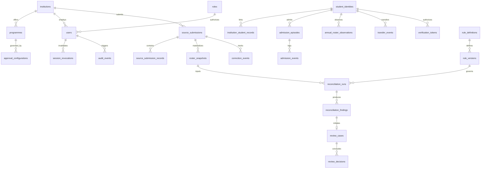

# APAAR SETU — Relational Database Schema Specification

**Document Version:** 1.1.0  
**Status:** Approved Architecture Draft  
**Database Engine:** PostgreSQL 16+ (Host: PostgreSQL 18)  
**Standard Identifiers:** UUIDv4 Primary Keys across all domain entities  

---

## 1. Architectural Principles & Invariants

1. **Decoupled Identity and Observation:**
   - A student identity (`student_identities`) exists independently of any institution, programme, admission episode, or annual roster appearance.
2. **Non-Destructive Versioned Observations:**
   - Multiple historical observations for the same student, programme, and academic year are preserved across successive submission versions. No unique constraint prevents historical revision tracking.
   - Reconciliation engines query explicit authoritative snapshots (`roster_snapshots`) rather than raw unbounded observations.
3. **Submission Immutability & Contextual Idempotency:**
   - Raw submissions (`source_submissions`) and parsed rows (`source_submission_records`) are append-only.
   - Deletions are forbidden: no cascading deletion (`ON DELETE CASCADE`) on historical submission records.
   - Idempotency is scoped strictly to the submission context:
     `UNIQUE(institution_id, programme_id, academic_year, submission_type, file_fingerprint)`.
4. **Reproducible Determinism:**
   - `reconciliation_runs` captures immutable pointers to the engine version, algorithm version, configuration snapshot, rule versions, identity resolution overrides, and canonical serialization formats.
5. **Tamper-Evident Audit & Concurrency Control:**
   - Every write transaction affecting state generates an `audit_events` row chained via SHA-256.
   - Concurrent chain mutations are serialized via PostgreSQL transaction-level advisory locks (`pg_advisory_xact_lock`).

---

## 2. Entity-Relationship Model Overview



---

## 3. Detailed Table Specifications

### 3.1 Institutions & Academic Configurations

#### `institutions`
Represents an AICTE-approved educational institution.
```sql
CREATE TABLE institutions (
    id UUID PRIMARY KEY DEFAULT gen_random_uuid(),
    institution_code VARCHAR(50) UNIQUE NOT NULL,
    name VARCHAR(255) NOT NULL,
    category VARCHAR(50) NOT NULL, -- 'ENGINEERING', 'POLYTECHNIC', 'MANAGEMENT', 'PHARMACY'
    approval_status VARCHAR(50) NOT NULL DEFAULT 'APPROVED', -- 'APPROVED', 'PROVISIONAL', 'SUSPENDED'
    address TEXT,
    state VARCHAR(100) NOT NULL,
    district VARCHAR(100) NOT NULL,
    pincode VARCHAR(10),
    contact_email VARCHAR(255),
    created_at TIMESTAMPTZ NOT NULL DEFAULT NOW(),
    updated_at TIMESTAMPTZ NOT NULL DEFAULT NOW()
);

CREATE INDEX idx_institutions_state ON institutions(state);
CREATE INDEX idx_institutions_code ON institutions(institution_code);
```

#### `programmes`
Academic programmes offered by an institution.
```sql
CREATE TABLE programmes (
    id UUID PRIMARY KEY DEFAULT gen_random_uuid(),
    institution_id UUID NOT NULL REFERENCES institutions(id) ON DELETE RESTRICT,
    programme_code VARCHAR(50) NOT NULL,
    programme_name VARCHAR(255) NOT NULL,
    qualification_level VARCHAR(50) NOT NULL, -- 'DIPLOMA', 'UG', 'PG'
    duration_years INT NOT NULL DEFAULT 4,
    status VARCHAR(50) NOT NULL DEFAULT 'ACTIVE', -- 'ACTIVE', 'DISCONTINUED'
    created_at TIMESTAMPTZ NOT NULL DEFAULT NOW(),
    updated_at TIMESTAMPTZ NOT NULL DEFAULT NOW(),
    CONSTRAINT uq_institution_programme UNIQUE (institution_id, programme_code),
    -- Enables composite foreign keys ensuring child entities belong to this institution:
    CONSTRAINT uq_institution_programme_id UNIQUE (institution_id, id)
);

CREATE INDEX idx_programmes_institution ON programmes(institution_id);
```

#### `approval_configurations`
Statutory intake capacity and regulatory caps versioned by academic year and effective temporal dates.
```sql
CREATE TABLE approval_configurations (
    id UUID PRIMARY KEY DEFAULT gen_random_uuid(),
    institution_id UUID NOT NULL REFERENCES institutions(id) ON DELETE RESTRICT,
    programme_id UUID NOT NULL REFERENCES programmes(id) ON DELETE RESTRICT,
    academic_year VARCHAR(20) NOT NULL, -- e.g. '2024-25'
    approved_intake INT NOT NULL,
    supernumerary_quota_percentage NUMERIC(5,2) NOT NULL DEFAULT 15.00,
    lateral_entry_quota_percentage NUMERIC(5,2) NOT NULL DEFAULT 10.00,
    approval_reference VARCHAR(100) NOT NULL, -- e.g. AICTE EoA reference number
    effective_from DATE NOT NULL,
    effective_to DATE NOT NULL,
    configuration_version INT NOT NULL DEFAULT 1,
    status VARCHAR(50) NOT NULL DEFAULT 'ACTIVE', -- 'ACTIVE', 'SUPERSEDED', 'REVOKED'
    created_at TIMESTAMPTZ NOT NULL DEFAULT NOW(),
    CONSTRAINT uq_approval_config_version UNIQUE (programme_id, academic_year, configuration_version),
    CONSTRAINT chk_approval_dates CHECK (effective_to >= effective_from),
    CONSTRAINT chk_positive_intake CHECK (approved_intake > 0)
);

CREATE INDEX idx_approval_configs_lookup ON approval_configurations(programme_id, academic_year, status);
```

---

### 3.2 Access Management & Security

#### `roles`
Role-based permission sets.
```sql
CREATE TABLE roles (
    id UUID PRIMARY KEY DEFAULT gen_random_uuid(),
    role_name VARCHAR(50) UNIQUE NOT NULL, -- 'SYSTEM_ADMIN', 'REGULATORY_REVIEWER', 'INSTITUTION_ADMIN', 'STUDENT_VERIFIER'
    description TEXT,
    permissions JSONB NOT NULL DEFAULT '{}',
    created_at TIMESTAMPTZ NOT NULL DEFAULT NOW()
);
```

#### `users`
Authenticated actors with strict institutional tenancy binding.
```sql
CREATE TABLE users (
    id UUID PRIMARY KEY DEFAULT gen_random_uuid(),
    name VARCHAR(255) NOT NULL,
    email VARCHAR(255) UNIQUE NOT NULL,
    password_hash VARCHAR(255) NOT NULL, -- Argon2id hash ($argon2id$v=19$m=65536,t=3,p=4$...)
    role_id UUID NOT NULL REFERENCES roles(id) ON DELETE RESTRICT,
    institution_id UUID REFERENCES institutions(id) ON DELETE RESTRICT, -- NULL for regulatory / system admins
    status VARCHAR(50) NOT NULL DEFAULT 'ACTIVE', -- 'ACTIVE', 'INACTIVE', 'SUSPENDED'
    last_login_at TIMESTAMPTZ,
    created_at TIMESTAMPTZ NOT NULL DEFAULT NOW(),
    updated_at TIMESTAMPTZ NOT NULL DEFAULT NOW()
);

CREATE INDEX idx_users_institution ON users(institution_id);
CREATE INDEX idx_users_email ON users(email);
```

#### `session_revocations`
Tracks revoked JWT tokens (JTI) and revoked refresh tokens for immediate session invalidation.
```sql
CREATE TABLE session_revocations (
    id UUID PRIMARY KEY DEFAULT gen_random_uuid(),
    user_id UUID NOT NULL REFERENCES users(id) ON DELETE CASCADE,
    jti VARCHAR(64) UNIQUE NOT NULL,
    revocation_reason VARCHAR(100),
    revoked_at TIMESTAMPTZ NOT NULL DEFAULT NOW(),
    expires_at TIMESTAMPTZ NOT NULL
);

CREATE INDEX idx_session_revocations_jti ON session_revocations(jti);
CREATE INDEX idx_session_revocations_expiry ON session_revocations(expires_at);
```

---

### 3.3 Student Identity, Admission & Observations

#### `student_identities`
The global identity anchor. Completely independent of institutions.
```sql
CREATE TABLE student_identities (
    id UUID PRIMARY KEY DEFAULT gen_random_uuid(),
    internal_student_uuid UUID UNIQUE NOT NULL DEFAULT gen_random_uuid(),
    encrypted_apaar_reference TEXT, -- AES-256-GCM ciphertext (format: "enc:v1:<iv>:<tag>:<ciphertext>")
    masked_apaar_reference VARCHAR(50), -- e.g. "XXXX-XXXX-1234"
    apaar_blind_index VARCHAR(64), -- HMAC-SHA256(raw_apaar, BLIND_INDEX_SECRET_KEY) for exact match
    full_name VARCHAR(255) NOT NULL,
    date_of_birth DATE,
    gender VARCHAR(20),
    identity_status VARCHAR(50) NOT NULL DEFAULT 'UNVERIFIED', -- 'MISSING_APAAR', 'FORMAT_VALID', 'EXTERNALLY_VERIFIED', 'DISPUTED'
    created_at TIMESTAMPTZ NOT NULL DEFAULT NOW(),
    updated_at TIMESTAMPTZ NOT NULL DEFAULT NOW()
);

CREATE INDEX idx_student_identities_uuid ON student_identities(internal_student_uuid);
-- Database-enforced uniqueness of non-null APAAR HMAC blind indexes (prevents concurrent duplicate global identities):
CREATE UNIQUE INDEX uq_student_identities_apaar_blind_index 
ON student_identities(apaar_blind_index) 
WHERE apaar_blind_index IS NOT NULL;
```

#### `institution_student_records`
Links a global student identity to an institution-assigned student ID (roll number / registration number).
```sql
CREATE TABLE institution_student_records (
    id UUID PRIMARY KEY DEFAULT gen_random_uuid(),
    student_identity_id UUID NOT NULL REFERENCES student_identities(id) ON DELETE RESTRICT,
    institution_id UUID NOT NULL REFERENCES institutions(id) ON DELETE RESTRICT,
    institution_student_id VARCHAR(100) NOT NULL,
    programme_id UUID NOT NULL REFERENCES programmes(id) ON DELETE RESTRICT,
    status VARCHAR(50) NOT NULL DEFAULT 'ENROLLED', -- 'ENROLLED', 'TRANSFERRED', 'WITHDRAWN', 'GRADUATED', 'SUSPENDED'
    created_at TIMESTAMPTZ NOT NULL DEFAULT NOW(),
    updated_at TIMESTAMPTZ NOT NULL DEFAULT NOW(),
    CONSTRAINT uq_inst_student_id UNIQUE (institution_id, institution_student_id)
);

CREATE INDEX idx_inst_records_lookup ON institution_student_records(institution_id, programme_id);
```

#### `admission_episodes`
Records a discrete admission event for a student into a specific programme and academic year.
```sql
CREATE TABLE admission_episodes (
    id UUID PRIMARY KEY DEFAULT gen_random_uuid(),
    student_identity_id UUID NOT NULL REFERENCES student_identities(id) ON DELETE RESTRICT,
    institution_id UUID NOT NULL REFERENCES institutions(id) ON DELETE RESTRICT,
    programme_id UUID NOT NULL REFERENCES programmes(id) ON DELETE RESTRICT,
    academic_year VARCHAR(20) NOT NULL,
    admission_date DATE NOT NULL,
    admission_category VARCHAR(50) NOT NULL, -- 'REGULAR', 'LATERAL_ENTRY', 'MANAGEMENT_QUOTA', 'GOVERNMENT_QUOTA', 'SUPERNUMERARY'
    supernumerary_status BOOLEAN NOT NULL DEFAULT FALSE,
    nri_status BOOLEAN NOT NULL DEFAULT FALSE,
    oci_status BOOLEAN NOT NULL DEFAULT FALSE,
    foreign_national_status BOOLEAN NOT NULL DEFAULT FALSE,
    source_submission_id UUID,
    created_at TIMESTAMPTZ NOT NULL DEFAULT NOW()
);

CREATE INDEX idx_admission_episodes_lookup ON admission_episodes(institution_id, programme_id, academic_year);
```

#### `admission_events`
Discrete lifecycle event logging the legal intake event.
```sql
CREATE TABLE admission_events (
    id UUID PRIMARY KEY DEFAULT gen_random_uuid(),
    admission_episode_id UUID NOT NULL REFERENCES admission_episodes(id) ON DELETE RESTRICT,
    student_identity_id UUID NOT NULL REFERENCES student_identities(id) ON DELETE RESTRICT,
    institution_id UUID NOT NULL REFERENCES institutions(id) ON DELETE RESTRICT,
    programme_id UUID NOT NULL REFERENCES programmes(id) ON DELETE RESTRICT,
    academic_year VARCHAR(20) NOT NULL,
    event_type VARCHAR(50) NOT NULL, -- 'FRESH_ADMISSION', 'LATERAL_ENTRY', 'SUPERNUMERARY_INTAKE'
    event_date DATE NOT NULL,
    evidence_reference_id UUID,
    source_submission_id UUID,
    created_at TIMESTAMPTZ NOT NULL DEFAULT NOW()
);

CREATE INDEX idx_admission_events_inst_year ON admission_events(institution_id, academic_year);
```

#### `annual_roster_observations`
Preserves student observations across multiple submission versions.
**CRITICAL INVARIANT:** No uniqueness constraint prevents multiple historical observations for the same student/programme/academic year. Successive uploads generate versioned observations.
```sql
CREATE TABLE annual_roster_observations (
    id UUID PRIMARY KEY DEFAULT gen_random_uuid(),
    student_identity_id UUID NOT NULL REFERENCES student_identities(id) ON DELETE RESTRICT,
    institution_id UUID NOT NULL REFERENCES institutions(id) ON DELETE RESTRICT,
    programme_id UUID NOT NULL REFERENCES programmes(id) ON DELETE RESTRICT,
    academic_year VARCHAR(20) NOT NULL,
    student_status VARCHAR(50) NOT NULL DEFAULT 'ACTIVE', -- 'ACTIVE', 'DETAINED', 'ABSENT', 'ON_LEAVE'
    source_submission_id UUID NOT NULL REFERENCES source_submissions(id) ON DELETE RESTRICT,
    source_record_id UUID NOT NULL,
    observation_timestamp TIMESTAMPTZ NOT NULL DEFAULT NOW(),
    observation_metadata JSONB NOT NULL DEFAULT '{}',
    -- Relational integrity constraint ensuring source record belongs to referenced submission:
    CONSTRAINT fk_roster_obs_source_record 
        FOREIGN KEY (source_record_id, source_submission_id) 
        REFERENCES source_submission_records(id, submission_id) ON DELETE RESTRICT,
        
    -- Relational integrity constraint ensuring observation matches submission context (institution, programme, year):
    CONSTRAINT fk_roster_obs_context 
        FOREIGN KEY (source_submission_id, institution_id, programme_id, academic_year) 
        REFERENCES source_submissions(id, institution_id, programme_id, academic_year) ON DELETE RESTRICT
);

-- Compound index for fast timeline querying across academic years
CREATE INDEX idx_roster_observations_timeline 
ON annual_roster_observations(institution_id, programme_id, academic_year, student_identity_id);

CREATE INDEX idx_roster_observations_submission 
ON annual_roster_observations(source_submission_id);
```

#### `transfer_events`
Documents sanctioned inter-institutional student movement.
```sql
CREATE TABLE transfer_events (
    id UUID PRIMARY KEY DEFAULT gen_random_uuid(),
    student_identity_id UUID NOT NULL REFERENCES student_identities(id) ON DELETE RESTRICT,
    source_institution_id UUID NOT NULL REFERENCES institutions(id) ON DELETE RESTRICT,
    destination_institution_id UUID NOT NULL REFERENCES institutions(id) ON DELETE RESTRICT,
    source_programme_id UUID NOT NULL REFERENCES programmes(id) ON DELETE RESTRICT,
    destination_programme_id UUID NOT NULL REFERENCES programmes(id) ON DELETE RESTRICT,
    academic_year VARCHAR(20) NOT NULL,
    transfer_date DATE NOT NULL,
    verification_status VARCHAR(50) NOT NULL DEFAULT 'PENDING', -- 'PENDING', 'DOCUMENTED', 'REJECTED'
    evidence_reference_id UUID,
    created_at TIMESTAMPTZ NOT NULL DEFAULT NOW()
);

CREATE INDEX idx_transfers_source ON transfer_events(source_institution_id, academic_year);
CREATE INDEX idx_transfers_dest ON transfer_events(destination_institution_id, academic_year);
```

---

### 3.4 Submissions, Snapshots & Idempotency

#### `source_submissions`
Immutable ledger of uploaded ingestion files, tenancy bindings, and lifecycle state transitions.
```sql
CREATE TABLE source_submissions (
    id UUID PRIMARY KEY DEFAULT gen_random_uuid(),
    institution_id UUID NOT NULL REFERENCES institutions(id) ON DELETE RESTRICT,
    programme_id UUID NOT NULL REFERENCES programmes(id) ON DELETE RESTRICT,
    academic_year VARCHAR(20) NOT NULL, -- e.g. '2024-25'
    submission_type VARCHAR(50) NOT NULL, -- 'ANNUAL_ROSTER', 'ADMISSION_BATCH', 'CORRECTION'
    
    -- Submission Lifecycle States (Corrected finite state machine)
    submission_status VARCHAR(50) NOT NULL DEFAULT 'UPLOADED',
    -- Permitted states: 'UPLOADED', 'VALIDATING', 'PREVIEW_READY', 
    --                  'INGESTING', 'COMMITTED', 'VALIDATION_FAILED', 
    --                  'FAILED', 'CANCELLED'
    
    original_filename VARCHAR(255) NOT NULL,
    storage_key VARCHAR(255) NOT NULL, -- Randomized UUID storage path: e.g. 'uploads/d4e5f6...dat' (never trust client filename)
    file_fingerprint VARCHAR(64) NOT NULL, -- SHA-256 hex digest of uploaded raw bytes
    file_size_bytes BIGINT NOT NULL,
    mime_type VARCHAR(100),
    client_idempotency_key VARCHAR(128), -- HTTP Idempotency-Key header value
    
    -- Processing Metrics & Counts
    total_rows_count INT NOT NULL DEFAULT 0,
    valid_rows_count INT NOT NULL DEFAULT 0,
    error_rows_count INT NOT NULL DEFAULT 0,
    warning_rows_count INT NOT NULL DEFAULT 0,
    duplicate_rows_count INT NOT NULL DEFAULT 0,
    
    mapping_config JSONB NOT NULL DEFAULT '{}',
    validation_summary JSONB NOT NULL DEFAULT '{}',
    failure_reason TEXT, -- Sanitized failure reason populated in isolated transaction upon rollback
    
    uploaded_by_user_id UUID NOT NULL REFERENCES users(id) ON DELETE RESTRICT,
    created_at TIMESTAMPTZ NOT NULL DEFAULT NOW(),
    updated_at TIMESTAMPTZ NOT NULL DEFAULT NOW(),
    committed_at TIMESTAMPTZ,
    
    -- Cancellation Evidence Retention
    cancelled_at TIMESTAMPTZ,
    cancelled_by_user_id UUID REFERENCES users(id) ON DELETE SET NULL,
    
    -- Relational Integrity: Enforce programme belongs to target institution:
    CONSTRAINT fk_submission_programme 
        FOREIGN KEY (institution_id, programme_id) 
        REFERENCES programmes(institution_id, id) ON DELETE RESTRICT,
        
    -- Composite Anchor enabling child snapshots and observations to guarantee identical context:
    CONSTRAINT uq_submission_relational_anchor 
        UNIQUE (id, institution_id, programme_id, academic_year)
);

CREATE INDEX idx_submissions_lookup ON source_submissions(institution_id, academic_year, submission_type);
CREATE INDEX idx_submissions_status ON source_submissions(submission_status);

-- Database-enforced tenant-scoped idempotency key uniqueness for non-null values:
CREATE UNIQUE INDEX uq_source_submissions_tenant_idempotency 
    ON source_submissions(institution_id, client_idempotency_key) 
    WHERE client_idempotency_key IS NOT NULL;

-- Database-enforced retry-safe contextual deduplication:
-- Prevents duplicate submissions while active or committed, but allows clean retries after FAILED or CANCELLED:
CREATE UNIQUE INDEX uq_active_context_fingerprint 
    ON source_submissions (institution_id, programme_id, academic_year, submission_type, file_fingerprint) 
    WHERE submission_status NOT IN ('FAILED', 'CANCELLED');
```

#### `submission_previews`
Immutable preview versions binding reviewed column mappings and validation summaries to subsequent confirmation.
```sql
CREATE TABLE submission_previews (
    id UUID PRIMARY KEY DEFAULT gen_random_uuid(),
    submission_id UUID NOT NULL REFERENCES source_submissions(id) ON DELETE RESTRICT,
    file_fingerprint VARCHAR(64) NOT NULL, -- Must match current submission.file_fingerprint
    column_mapping JSONB NOT NULL, -- Confirmed column-to-field dictionary
    mapping_version VARCHAR(50) NOT NULL DEFAULT 'v1.0',
    mapping_hash VARCHAR(64) NOT NULL, -- SHA-256 of canonical sorted mapping JSON
    validation_summary JSONB NOT NULL DEFAULT '{}',
    is_active BOOLEAN NOT NULL DEFAULT TRUE, -- Only one active preview per submission at a time
    created_at TIMESTAMPTZ NOT NULL DEFAULT NOW()
);

CREATE INDEX idx_submission_previews_lookup ON submission_previews(submission_id, is_active);
CREATE INDEX idx_submission_previews_hash ON submission_previews(mapping_hash);
```
```

#### `source_submission_records`
Immutable row-level storage preserving complete raw source evidence and provenance for every parsed record.
**CRITICAL INVARIANTS:** 
1. **Raw Evidence Preservation:** Raw cell values are preserved verbatim in `raw_payload`. Never prefix raw values with apostrophes or mutate them. Formula evaluation is disabled; formula strings and cached values are recorded in `formula_metadata`.
2. Append-only; no cascading deletion (`ON DELETE RESTRICT` from submission).
3. Never overwritten when mappings or validation rules change.
4. Composite uniqueness `UNIQUE (id, submission_id)` guarantees row belongs strictly to the referenced submission.
```sql
CREATE TABLE source_submission_records (
    id UUID PRIMARY KEY DEFAULT gen_random_uuid(),
    submission_id UUID NOT NULL REFERENCES source_submissions(id) ON DELETE RESTRICT,
    row_number INT NOT NULL, -- 1-based original line number in uploaded file
    raw_payload JSONB NOT NULL, -- Verbatim unaltered cell data dictionary (formulas unmutated)
    parsed_payload JSONB NOT NULL, -- Normalized dictionary (trimmed strings, uppercase IDs)
    formula_metadata JSONB NOT NULL DEFAULT '{}', -- Captures formula text, cached values, and cached status
    validation_status VARCHAR(50) NOT NULL DEFAULT 'VALID', -- 'VALID', 'WARNING', 'INVALID', 'DUPLICATE'
    errors JSONB NOT NULL DEFAULT '[]', -- List of error strings/objects
    warnings JSONB NOT NULL DEFAULT '[]', -- List of non-fatal warnings (e.g. format non-compliance)
    mapping_version VARCHAR(50) NOT NULL DEFAULT 'v1.0',
    
    -- Resolved Entity Links (populated during transactional commit)
    resolved_student_identity_id UUID REFERENCES student_identities(id) ON DELETE SET NULL,
    resolved_institution_student_record_id UUID REFERENCES institution_student_records(id) ON DELETE SET NULL,
    
    created_at TIMESTAMPTZ NOT NULL DEFAULT NOW(),
    processed_at TIMESTAMPTZ,
    
    CONSTRAINT uq_submission_record_row UNIQUE (submission_id, row_number),
    -- Enables composite foreign keys ensuring observations link to the same submission:
    CONSTRAINT uq_submission_record_composite UNIQUE (id, submission_id)
);

CREATE INDEX idx_submission_records_subid ON source_submission_records(submission_id);
CREATE INDEX idx_submission_records_identity ON source_submission_records(resolved_student_identity_id);
```

#### `roster_snapshots`
The authoritative snapshot selection mechanism for reconciliation. Decouples raw multi-version observations from regulatory analysis.
**CRITICAL INVARIANTS:**
1. Completeness (`COMPLETE`, `PARTIAL`, `UNKNOWN`) is strictly decoupled from lifecycle state (`ACTIVE`, `SUPERSEDED`).
2. An authoritative snapshot may be `COMPLETE` or `PARTIAL`. Authoritative selection denotes **regulatory validity**, not complete headcount enumeration.
3. Database constraint enforces consistency: an authoritative snapshot cannot have lifecycle status `SUPERSEDED`.
4. Zero authoritative snapshots may exist before first selection.
5. Exactly one snapshot may be authoritative per `(institution_id, programme_id, academic_year)` at any time, enforced by a partial unique index.
6. Promotion is serialized via PostgreSQL transaction-level advisory locks (`pg_advisory_xact_lock`) and executed atomically.
7. Composite foreign key strictly guarantees the snapshot matches its source submission's institution, programme, and academic year.
```sql
CREATE TABLE roster_snapshots (
    id UUID PRIMARY KEY DEFAULT gen_random_uuid(),
    institution_id UUID NOT NULL REFERENCES institutions(id) ON DELETE RESTRICT,
    programme_id UUID NOT NULL REFERENCES programmes(id) ON DELETE RESTRICT,
    academic_year VARCHAR(20) NOT NULL,
    source_submission_id UUID NOT NULL,
    
    -- Decoupled Dimensions
    completeness_status VARCHAR(50) NOT NULL DEFAULT 'UNKNOWN', -- 'COMPLETE', 'PARTIAL', 'UNKNOWN'
    lifecycle_status VARCHAR(50) NOT NULL DEFAULT 'ACTIVE',     -- 'ACTIVE', 'SUPERSEDED'
    is_authoritative BOOLEAN NOT NULL DEFAULT FALSE,           -- Promoted explicitly
    
    -- Headcount Definitions
    -- declared_headcount: Total student count declared in submission header or metadata
    declared_headcount INT NOT NULL DEFAULT 0,
    -- observed_headcount: Count of distinct, valid student records ingested into snapshot
    observed_headcount INT NOT NULL DEFAULT 0,
    
    -- Canonicalization Algorithm Version & Hash
    -- snapshot_hash: SHA-256 of sorted internal_student_uuid values (NO plaintext APAAR!)
    snapshot_canonicalization_version VARCHAR(50) NOT NULL DEFAULT 'v1-sha256-sorted-uuids',
    snapshot_hash VARCHAR(64) NOT NULL,
    snapshot_metadata JSONB NOT NULL DEFAULT '{}',
    
    effective_from TIMESTAMPTZ NOT NULL DEFAULT NOW(),
    superseded_by_snapshot_id UUID REFERENCES roster_snapshots(id) ON DELETE SET NULL,
    superseded_at TIMESTAMPTZ,
    
    created_by_user_id UUID NOT NULL REFERENCES users(id) ON DELETE RESTRICT,
    created_at TIMESTAMPTZ NOT NULL DEFAULT NOW(),
    
    -- Relational Integrity: Enforce snapshot matches source submission context:
    CONSTRAINT fk_snapshot_submission 
        FOREIGN KEY (source_submission_id, institution_id, programme_id, academic_year) 
        REFERENCES source_submissions(id, institution_id, programme_id, academic_year) ON DELETE RESTRICT,
        
    -- Consistency Constraint: Authoritative snapshots MUST NOT be marked SUPERSEDED:
    CONSTRAINT chk_authoritative_lifecycle 
        CHECK (NOT (is_authoritative = TRUE AND lifecycle_status = 'SUPERSEDED'))
);

-- Partial unique index guaranteeing at most ONE authoritative snapshot per institution, programme, and academic year
CREATE UNIQUE INDEX idx_uq_authoritative_snapshot 
ON roster_snapshots(institution_id, programme_id, academic_year) 
WHERE is_authoritative = TRUE;

CREATE INDEX idx_snapshots_lookup 
ON roster_snapshots(institution_id, programme_id, academic_year);
CREATE INDEX idx_snapshots_lifecycle 
ON roster_snapshots(lifecycle_status, is_authoritative);
```

---

### 3.5 Rules, Reconciliation Runs & Reproducibility

#### `rule_definitions`
```sql
CREATE TABLE rule_definitions (
    id UUID PRIMARY KEY DEFAULT gen_random_uuid(),
    rule_code VARCHAR(50) UNIQUE NOT NULL, -- e.g. 'RULE_INTAKE_CAP', 'RULE_COHORT_CONTINUITY'
    name VARCHAR(255) NOT NULL,
    description TEXT,
    rule_category VARCHAR(50) NOT NULL -- 'INTAKE_CAP', 'COHORT_CONTINUITY', 'CROSS_INSTITUTION', 'FORMAT_VALIDATION'
);
```

#### `rule_versions`
```sql
CREATE TABLE rule_versions (
    id UUID PRIMARY KEY DEFAULT gen_random_uuid(),
    rule_definition_id UUID NOT NULL REFERENCES rule_definitions(id) ON DELETE RESTRICT,
    version INT NOT NULL DEFAULT 1,
    configuration JSONB NOT NULL DEFAULT '{}',
    effective_from DATE NOT NULL,
    effective_to DATE,
    source_reference VARCHAR(255),
    CONSTRAINT uq_rule_version UNIQUE (rule_definition_id, version)
);
```

#### `reconciliation_runs`
Complete execution trace preserving everything necessary for byte-for-byte reproducibility.
```sql
CREATE TABLE reconciliation_runs (
    id UUID PRIMARY KEY DEFAULT gen_random_uuid(),
    run_code VARCHAR(64) UNIQUE NOT NULL,
    institution_id UUID NOT NULL REFERENCES institutions(id) ON DELETE RESTRICT,
    programme_id UUID NOT NULL REFERENCES programmes(id) ON DELETE RESTRICT,
    base_academic_year VARCHAR(20) NOT NULL,
    target_academic_year VARCHAR(20) NOT NULL,
    
    -- Reproducibility metadata
    engine_version VARCHAR(50) NOT NULL DEFAULT '1.0.0',
    algorithm_version VARCHAR(50) NOT NULL DEFAULT 'cohort-v2026.1',
    canonical_serialization_version VARCHAR(50) NOT NULL DEFAULT 'canonical-json-v1',
    configuration_snapshot JSONB NOT NULL,
    source_snapshot_ids JSONB NOT NULL, -- Array of roster_snapshot UUIDs
    rule_version_ids JSONB NOT NULL,     -- Array of rule_version UUIDs
    identity_resolution_decisions JSONB NOT NULL DEFAULT '[]', -- Applied manual reviewer overrides
    
    -- Verification hashes
    input_provenance_hash VARCHAR(64) NOT NULL, -- SHA-256 of canonical inputs
    output_provenance_hash VARCHAR(64),         -- SHA-256 of canonical findings
    
    status VARCHAR(50) NOT NULL DEFAULT 'STARTED', -- 'STARTED', 'COMPLETED', 'FAILED'
    execution_summary JSONB NOT NULL DEFAULT '{}',
    started_at TIMESTAMPTZ NOT NULL DEFAULT NOW(),
    completed_at TIMESTAMPTZ,
    run_by UUID NOT NULL REFERENCES users(id) ON DELETE RESTRICT
);

CREATE INDEX idx_reconciliation_runs_inst ON reconciliation_runs(institution_id, programme_id);
```

#### `reconciliation_findings`
```sql
CREATE TABLE reconciliation_findings (
    id UUID PRIMARY KEY DEFAULT gen_random_uuid(),
    reconciliation_run_id UUID NOT NULL REFERENCES reconciliation_runs(id) ON DELETE RESTRICT,
    student_identity_id UUID REFERENCES student_identities(id) ON DELETE RESTRICT,
    finding_type VARCHAR(50) NOT NULL, 
    -- 'CONTINUING_STUDENT', 'DOCUMENTED_TRANSFER_IN', 'DOCUMENTED_TRANSFER_OUT',
    -- 'UNEXPLAINED_APPEARANCE', 'UNEXPLAINED_DISAPPEARANCE', 'INTAKE_EXCESS',
    -- 'CROSS_INSTITUTION_CONFLICT', 'AGGREGATE_VARIANCE', 'UNCERTAIN_HISTORICAL_BASELINE'
    priority VARCHAR(20) NOT NULL, -- 'LOW', 'MEDIUM', 'HIGH', 'CRITICAL'
    explanation TEXT NOT NULL,
    uncertainty_state VARCHAR(50) NOT NULL DEFAULT 'CONFIRMED', -- 'CONFIRMED', 'UNCERTAIN', 'INSUFFICIENT_EVIDENCE'
    status VARCHAR(50) NOT NULL DEFAULT 'OPEN', -- 'OPEN', 'UNDER_INVESTIGATION', 'RESOLVED', 'DISMISSED'
    evidence_reference_id UUID,
    created_at TIMESTAMPTZ NOT NULL DEFAULT NOW()
);

CREATE INDEX idx_findings_run ON reconciliation_findings(reconciliation_run_id);
CREATE INDEX idx_findings_type ON reconciliation_findings(finding_type);
```

---

### 3.6 Discrepancies, Decisions & Verification

#### `review_cases`
```sql
CREATE TABLE review_cases (
    id UUID PRIMARY KEY DEFAULT gen_random_uuid(),
    case_number VARCHAR(50) UNIQUE NOT NULL,
    finding_id UUID NOT NULL REFERENCES reconciliation_findings(id) ON DELETE RESTRICT,
    institution_id UUID NOT NULL REFERENCES institutions(id) ON DELETE RESTRICT,
    assigned_reviewer_id UUID REFERENCES users(id) ON DELETE SET NULL,
    case_status VARCHAR(50) NOT NULL DEFAULT 'OPEN', 
    -- 'OPEN', 'UNDER_REVIEW', 'EVIDENCE_REQUESTED', 'AWAITING_INSTITUTION_RESPONSE', 'RESOLVED', 'INSUFFICIENT_EVIDENCE', 'ESCALATED'
    priority VARCHAR(20) NOT NULL,
    created_at TIMESTAMPTZ NOT NULL DEFAULT NOW(),
    updated_at TIMESTAMPTZ NOT NULL DEFAULT NOW()
);

CREATE INDEX idx_review_cases_status ON review_cases(case_status, priority);
CREATE INDEX idx_review_cases_inst ON review_cases(institution_id);
```

#### `review_decisions`
```sql
CREATE TABLE review_decisions (
    id UUID PRIMARY KEY DEFAULT gen_random_uuid(),
    review_case_id UUID NOT NULL REFERENCES review_cases(id) ON DELETE RESTRICT,
    reviewer_id UUID NOT NULL REFERENCES users(id) ON DELETE RESTRICT,
    decision VARCHAR(50) NOT NULL, 
    -- 'CONFIRM_DISCREPANCY', 'MARK_LEGITIMATE_TRANSFER', 'REQUEST_EVIDENCE', 
    -- 'REQUEST_CORRECTION', 'MARK_INSUFFICIENT_EVIDENCE', 'RESOLVE_AFTER_CORRECTION', 'ESCALATE'
    reason TEXT NOT NULL,
    supporting_evidence JSONB NOT NULL DEFAULT '{}',
    previous_status VARCHAR(50) NOT NULL,
    new_status VARCHAR(50) NOT NULL,
    created_at TIMESTAMPTZ NOT NULL DEFAULT NOW()
);

CREATE INDEX idx_review_decisions_case ON review_decisions(review_case_id);
```

#### `verification_tokens`
Opaque, cryptographically random, revocable tokens for public verification and certificate QR codes.
```sql
CREATE TABLE verification_tokens (
    id UUID PRIMARY KEY DEFAULT gen_random_uuid(),
    token_value VARCHAR(64) UNIQUE NOT NULL, -- Cryptographically random base64url/hex token
    student_identity_id UUID NOT NULL REFERENCES student_identities(id) ON DELETE RESTRICT,
    institution_id UUID NOT NULL REFERENCES institutions(id) ON DELETE RESTRICT,
    programme_id UUID NOT NULL REFERENCES programmes(id) ON DELETE RESTRICT,
    certificate_reference VARCHAR(100),
    purpose VARCHAR(100) NOT NULL, -- 'DEGREE_VERIFICATION', 'EMPLOYER_CHECK', 'PUBLIC_BADGE'
    minimal_scope JSONB NOT NULL DEFAULT '{"name": true, "status": true, "institution": true, "programme": true}',
    expires_at TIMESTAMPTZ NOT NULL,
    is_revoked BOOLEAN NOT NULL DEFAULT FALSE,
    revoked_at TIMESTAMPTZ,
    revocation_reason TEXT,
    created_at TIMESTAMPTZ NOT NULL DEFAULT NOW()
);

CREATE INDEX idx_verification_tokens_lookup ON verification_tokens(token_value) WHERE is_revoked = FALSE;
```

#### `audit_events`
Append-only tamper-evident audit ledger protected by transaction-level serialization.
```sql
CREATE TABLE audit_events (
    id UUID PRIMARY KEY DEFAULT gen_random_uuid(),
    actor_id UUID REFERENCES users(id) ON DELETE SET NULL,
    action VARCHAR(100) NOT NULL,
    entity_type VARCHAR(50) NOT NULL,
    entity_id UUID,
    ip_address INET,
    user_agent TEXT,
    metadata JSONB NOT NULL DEFAULT '{}',
    previous_event_hash VARCHAR(64) NOT NULL,
    event_hash VARCHAR(64) NOT NULL,
    timestamp TIMESTAMPTZ NOT NULL DEFAULT NOW()
);

CREATE INDEX idx_audit_events_entity ON audit_events(entity_type, entity_id);
CREATE INDEX idx_audit_events_timestamp ON audit_events(timestamp);
```

---

## 4. Concurrency & Integrity Mechanics

### 4.1 Audit Hash-Chain Protection (Advisory Lock)
To guarantee strict sequence integrity without race conditions under high concurrent writes:
```sql
-- In the audit logging transaction:
SELECT pg_advisory_xact_lock(197410); -- Dedicated 64-bit application advisory lock ID

SELECT event_hash FROM audit_events ORDER BY timestamp DESC, id DESC LIMIT 1 FOR UPDATE;
-- Compute: new_hash = SHA256(previous_hash || actor_id || action || entity_id || timestamp || canonical(metadata))
INSERT INTO audit_events (actor_id, action, entity_type, entity_id, ip_address, metadata, previous_event_hash, event_hash)
VALUES (...);
```

### 4.2 Authoritative Snapshot Transition
When a new submission is marked authoritative:
```sql
BEGIN;
-- Demote current authoritative snapshot
UPDATE roster_snapshots
SET is_authoritative = FALSE,
    superseded_by_snapshot_id = :new_snapshot_id
WHERE institution_id = :inst_id 
  AND programme_id = :prog_id 
  AND academic_year = :acad_year 
  AND is_authoritative = TRUE;

-- Insert or activate new authoritative snapshot
INSERT INTO roster_snapshots (id, institution_id, programme_id, academic_year, source_submission_id, completeness_status, is_authoritative, declared_headcount, observed_headcount, snapshot_hash)
VALUES (:new_snapshot_id, :inst_id, :prog_id, :acad_year, :submission_id, :completeness, TRUE, :declared, :observed, :hash);
COMMIT;
```

