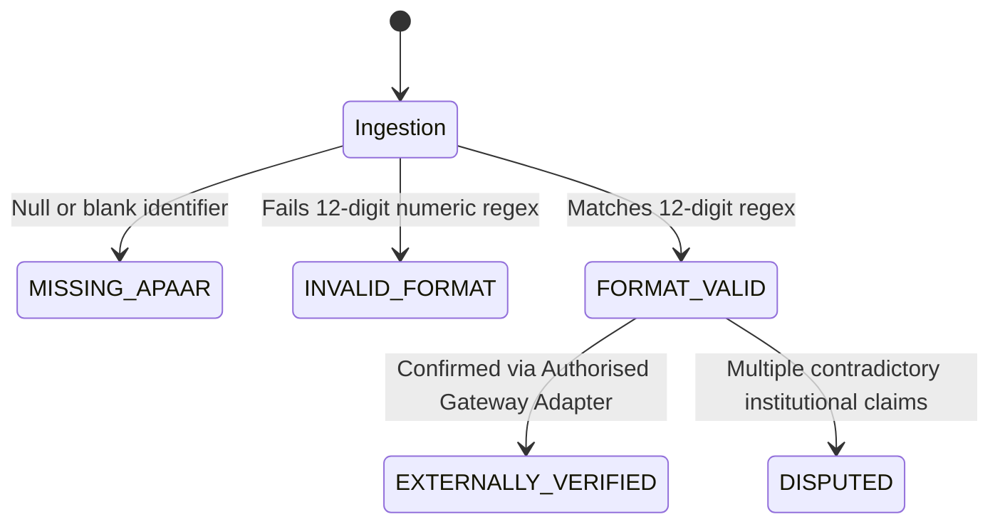

# APAAR SETU — Domain Rules & Regulatory Algorithms

**Document Version:** 1.1.0  
**Status:** Approved Architecture Draft  
**Focus:** Longitudinal Cohort Integrity, Documented APAAR Validation, Intake Reconciliation  

---

## 1. Longitudinal Cohort Integrity Engine

The Longitudinal Cohort Integrity Engine is the signature innovation of APAAR SETU. It reconstructs student population transitions across consecutive academic years, isolating unexplained cohort substitutions that are otherwise obscured by static headcount reporting.

### 1.1 Mathematical Formulation
Let $S_t$ and $S_{t+1}$ be the authoritative `roster_snapshots` for an institution and programme in consecutive academic years $t$ and $t+1$.  
Let $R(t) = \{ s_1, s_2, \dots, s_m \}$ and $R(t+1) = \{ s'_1, s'_2, \dots, s'_n \}$ be the respective sets of observed student identities.

$$N_t = |R(t)|, \quad N_{t+1} = |R(t+1)|$$

```mermaid
flowchart TD
    subgraph Inputs ["Snapshot Inputs"]
        R_T["R(t) Base Roster Snapshot (Completeness Status)"]
        R_T1["R(t+1) Target Roster Snapshot"]
        EVENTS["Documented Lifecycle Events (Transfers, Withdrawals, Admissions)"]
    end

    subgraph Partitioning ["Set Decomposition"]
        INT["Intersection: C = R(t) ∩ R(t+1)"]
        DEP["Departures: D = R(t) \\ R(t+1)"]
        ARR["Arrivals: A = R(t+1) \\ R(t)"]
    end

    subgraph Evaluation ["Policy & Completeness Evaluation"]
        GATE{"Is Base Snapshot COMPLETE?"}
        UNEXP_DISC["Unexplained Disappearance"]
        UNCERT_BASE["Uncertain Historical Baseline"]
        UNEXP_APP["Unexplained Appearance"]
        DOC_TR_IN["Documented Transfer-In"]
        DOC_TR_OUT["Documented Transfer-Out"]
    end

    R_T --> INT & DEP
    R_T1 --> INT & ARR
    DEP --> GATE
    GATE -->|Yes| UNEXP_DISC
    GATE -->|No (PARTIAL / UNKNOWN)| UNCERT_BASE
    EVENTS -->|Reconciles D| DOC_TR_OUT
    EVENTS -->|Reconciles A| DOC_TR_IN
    ARR -->|Unreconciled| UNEXP_APP
```

### 1.2 Snapshot Completeness, Lifecycle & Uncertainty Invariants

Every roster snapshot strictly decouples **completeness status** from **lifecycle status**:

1. **Completeness Dimension (`completeness_status`):**
   - `COMPLETE`: Full student census reported and confirmed by institution.
   - `PARTIAL`: Incomplete census (e.g. pending branch submissions, partial semester or supplementary batches).
   - `UNKNOWN`: Historical archive migrated without census verification.

2. **Lifecycle Dimension (`lifecycle_status`):**
   - `ACTIVE`: The current operating snapshot for this academic year.
   - `SUPERSEDED`: Replaced by a more recent or corrected submission snapshot.

3. **Authoritative Snapshot Invariants:**
   - An authoritative snapshot (`is_authoritative = TRUE`) represents **regulatory validity** and may be either `COMPLETE` or `PARTIAL`.
   - Consistency Rule: An authoritative snapshot **cannot** have `lifecycle_status = 'SUPERSEDED'`. (Enforced by DB check constraint `chk_authoritative_lifecycle`).
   - At most one snapshot may be authoritative per `(institution_id, programme_id, academic_year)` at any time (enforced by partial unique index `idx_uq_authoritative_snapshot`).
   - Concurrent promotions are serialized via PostgreSQL transaction advisory locks scoped to `(institution_id, programme_id, academic_year)`.
   - Changing the authoritative snapshot is strictly atomic: if a promotion transaction fails, the existing authoritative snapshot remains completely unchanged.

4. **Snapshot Canonicalization Algorithm (`v1-sha256-sorted-uuids`):**
   - Inputs: All observed student records belonging to the roster snapshot.
   - Identifier Extraction: Extracts the global `internal_student_uuid` for each record (provisional or format-valid).
   - Ordering & Deduplication: Forms a distinct set of UUID strings sorted lexicographically.
   - Privacy Invariant: **Plaintext APAAR identifiers are never included in snapshot hashes.**
   - Serialization: Serialized into canonical UTF-8 JSON array: `["0192e2b3...", "0192e2b4...", ...]`.
   - Digest: SHA-256 hex digest stored in `snapshot_hash`.
   - **Headcount Definitions:**
     - `declared_headcount`: The total student count declared in the submission header or import dialog.
     - `observed_headcount`: The count of distinct, valid student records ingested into the snapshot.

> **CRITICAL INVARIANT:**  
> If $S_t.\text{completeness\_status} \in \{\text{PARTIAL}, \text{UNKNOWN}\}$, missing observations in $R(t+1)$ **must not** generate `UNEXPLAINED_DISAPPEARANCE` findings.  
> They are strictly classified as `UNCERTAIN_HISTORICAL_BASELINE` with `uncertainty_state = 'INSUFFICIENT_EVIDENCE'`. An incomplete historical archive can never be used to declare that students have disappeared without justification.

### 1.3 Detailed Transition Classifications

| Transition Classification | Mathematical Condition | Evidence Requisite | Finding Priority |
| :--- | :--- | :--- | :--- |
| **`CONTINUING_STUDENT`** | $s \in R(t) \cap R(t+1)$ | Verified identity present in both snapshots | Informational |
| **`DOCUMENTED_TRANSFER_IN`** | $s \in R(t+1) \setminus R(t)$ | Verified `transfer_events` row with destination = current institution | Informational |
| **`DOCUMENTED_TRANSFER_OUT`** | $s \in R(t) \setminus R(t+1)$ | Verified `transfer_events` row with source = current institution | Informational |
| **`DOCUMENTED_WITHDRAWAL`** | $s \in R(t) \setminus R(t+1)$ | Verified institutional exit / withdrawal record | Informational |
| **`UNEXPLAINED_APPEARANCE`** | $s \in R(t+1) \setminus R(t)$ | No corresponding fresh admission, lateral entry, or transfer event | **HIGH** |
| **`UNEXPLAINED_DISAPPEARANCE`** | $s \in R(t) \setminus R(t+1)$ | Base roster is `COMPLETE` with no withdrawal or transfer event | **MEDIUM** |
| **`UNCERTAIN_HISTORICAL_BASELINE`**| $s \in R(t) \setminus R(t+1)$ | Base roster is `PARTIAL` or `UNKNOWN` | Low (Warning) |
| **`AMBIGUOUS_IDENTITY_MATCH`** | Name/DOB similar, APAAR missing | Similarity score $> 0.85$ without identity confirmation | Medium |

### 1.4 The Demonstration Scenario (CSE 120 $\rightarrow$ 120)
- **Base Academic Year (2024-25):** 120 students in CSE ($|R(t)| = 120$, `completeness = COMPLETE`).
- **Target Academic Year (2025-26):** 120 students in CSE ($|R(t+1)| = 120$).
- **Transition Execution:**
  - $|C| = |R(t) \cap R(t+1)| = 115$ (Continuing Students).
  - Arrivals: $|A| = 120 - 115 = 5$ students.
    - 2 students match documented lateral entry / transfer-in certificates (`DOCUMENTED_TRANSFER_IN`).
    - 3 students possess no intake event or transfer documentation (`UNEXPLAINED_APPEARANCE`).
  - Departures: $|D| = 120 - 115 = 5$ students.
    - 2 students have sanctioned transfers-out (`DOCUMENTED_TRANSFER_OUT`).
    - 3 students have unrecorded dropouts/exits (`UNEXPLAINED_DISAPPEARANCE`).
- **Result:** Static dashboard says headcount is unchanged ($120 \rightarrow 120$). APAAR SETU surfaces the 3 unexplained appearances and 3 unexplained disappearances for human regulatory review without making unsubstantiated automated accusations.

---

## 2. Documented APAAR Validation Rules

### 2.1 Format-Only Validation
In accordance with AICTE and Ministry of Education notifications, APAAR ID is a **12-digit numeric identifier**.
- **Regex Specification:** `^\d{12}$` or formatted as `^\d{4}-\d{4}-\d{4}$`.
- **Formatting Sanitization:** Strip spaces and hyphens before validating exact 12-digit length.
- **Rule Prohibition:** **DO NOT invent or enforce undocumented checksum algorithms** (e.g. Luhn, Verhoeff) unless formally specified in statutory circulars.

### 2.2 Discrete Identity Validity States
The system enforces strict separation between syntactic format validity and external institutional verification:



- **`MISSING_APAAR`:** Identifier is null, empty, or whitespace-only. Record is ingested as a reviewable provisional identity (`identity_status = 'MISSING_APAAR'`). Never causes rejection of the student observation.
- **`INVALID_FORMAT`:** Identifier is provided but non-numeric, wrong length (not 12 digits), or malformed. **CRITICAL INVARIANT:** Never create a canonical APAAR reference, AES-256 ciphertext, or HMAC blind index from an invalid identifier. Retained strictly as an unverified provisional record with a validation warning.
- **`FORMAT_VALID`:** Syntactically correct 12 numeric digits. In UI and reports, labeled **"Format Valid (Authenticity Unverified)"**. Never labeled as "Verified".
- **`EXTERNALLY_VERIFIED`:** Verified against simulated or authorised regulatory identity adapters.
- **`DISPUTED`:** Identity reference challenged by a student or flagged across conflicting institutional registrations.

### 2.3 Global Identity Resolution & Concurrency Invariant
- **Database-Enforced Uniqueness:** Non-null HMAC blind indexes are unique across the entire platform via `uq_student_identities_apaar_blind_index`.
- **Concurrent Identity Resolution:** When two independent submissions contain the same APAAR identifier, the database uniqueness constraint prevents duplicate global identity creation. The ingestion engine catches the conflict, fetches the existing `StudentIdentity`, and binds the second institution's `InstitutionStudentRecord` safely to that global anchor.
- **Missing/Invalid APAAR Handling:** Records with missing or malformed APAAR are retained and ingested as provisional identities with `identity_status = 'MISSING_APAAR'`. They are never dropped or ignored.
- **Weak Attribute Prohibition:** Weak attributes (e.g. matching student name and date of birth without APAAR) **must never** trigger automatic identity merging. They remain separate provisional identities until explicit, documented human reviewer resolution.

### 2.4 Parser, Formula & Content Invariants
- **Dual XLSX Inspection:** Workbooks are inspected with both `data_only=False` (to capture raw formulas) and `data_only=True` (to extract cached calculation values).
- **Missing Cached Values:** If a formula cell has no cached evaluation result, the parser generates a warning (`UNRESOLVED_FORMULA_NO_CACHED_VALUE`) and treats the value as unparseable/missing. Formulas and macros are **never** executed.
- **Content-Type & Magic Byte Validation:** Uploads are verified using magic bytes (ZIP header `PK\x03\x04` for XLSX, valid text stream for CSV) before parsing.
- **Configurable Limits:** Enforces environment-configured caps: max file size (10MB), max archive expansion (50MB), max compression ratio (20:1), max rows (25,000), max columns (50), and parser timeout (30 seconds).

---

## 3. Statutory Admission & Approved Intake Rules

### 3.1 Statutory Intake Limit Rule (`RULE_INTAKE_CAP`)
Evaluates total institutional intake against approved capacity from `approval_configurations`.
- **Approved Intake ($I_{\text{approved}}$):** Sanctioned capacity for regular first-year intake.
- **Supernumerary Quotas:** Approved categories (e.g. Tuition Fee Waiver (TFW 5%), Economically Weaker Section (EWS 10%), Jammu & Kashmir Migrants (PMSSS), NRI/OCI/PIO) are segregated from regular intake calculations.
- **Formula:**
  $$\text{Enrolled}_{\text{regular}} = \sum_{s \in \text{Admissions}} \mathbf{1}_{(\text{category} = \text{'REGULAR'} \land \text{supernumerary} = \text{FALSE})}$$
  $$\text{Variance}_{\text{intake}} = \text{Enrolled}_{\text{regular}} - I_{\text{approved}}$$

### 3.2 Evaluation Outcomes
- If $\text{Variance}_{\text{intake}} \le 0$: `COMPLIANT`.
- If $\text{Variance}_{\text{intake}} > 0$: `INTAKE_EXCESS` discrepancy generated, specifying the exact count and student IDs exceeding the approved threshold.
- If $I_{\text{approved}}$ is not configured for that academic year: Evaluates to `INSUFFICIENT_INFORMATION` (never an assumption of breach).

---

## 4. Cross-Institution Duplicate Detection Rules

Identifies concurrent, active enrolments of the same student identity across distinct institutions during overlapping academic periods.

### 4.1 Evaluation Criteria
Two records $R_A$ (Institution $A$) and $R_B$ (Institution $B$) form a conflict candidate if:
1. $R_A.\text{apaar\_blind\_index} = R_B.\text{apaar\_blind\_index}$.
2. Both records have `status = 'ENROLLED'`.
3. The academic years overlap (e.g., both active in `2024-25`).
4. No verified `transfer_events` row exists transitioning the student between $A$ and $B$.
5. The programme configuration does not permit formal concurrent enrolment (e.g., regular B.Tech + regular Diploma is disallowed; regular B.Tech + SWAYAM minor is allowed if configured).

### 4.2 Candidate Output
Creates a `CROSS_INSTITUTION_CONFLICT` review case containing:
- Both institution IDs and programme codes.
- Admission episode dates and timestamps.
- Opportunity for both institutions to upload Transfer Certificates (TC) or migration certificates before regulatory action.

