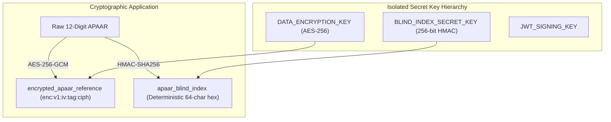
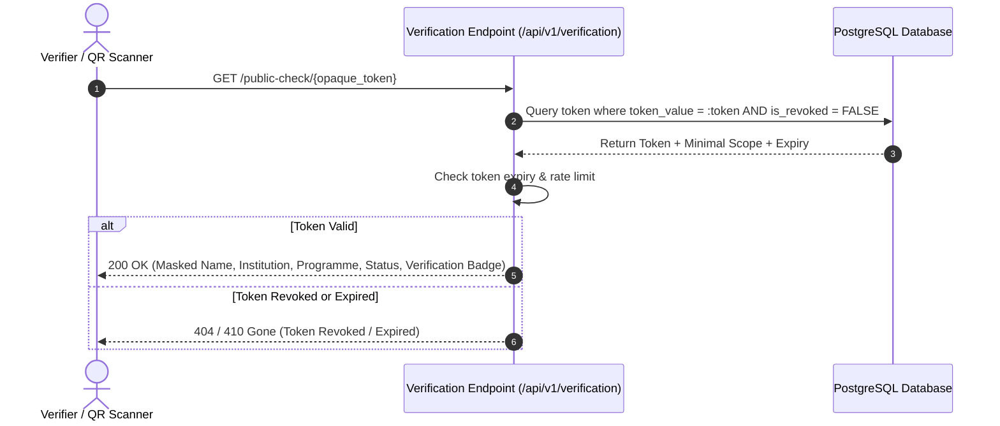

# APAAR SETU — Security, Privacy & Tenancy Model

**Document Version:** 1.1.0  
**Status:** Approved Architecture Draft  
**Compliance Standards:** Digital Personal Data Protection (DPDP) Act, AICTE Privacy Guidelines  

---

## 1. Authentication & Password Security

### 1.1 Argon2id Password Hashing
All user credentials are encrypted using **Argon2id** (the state-of-the-art memory-hard password hashing algorithm), resisting GPU/ASIC brute-force attacks.
- **Parameters:**
  - Algorithm: Argon2id (v=19)
  - Memory cost ($m$): $65,536\text{ KiB}$ ($64\text{ MB}$)
  - Time cost ($t$): $3\text{ iterations}$
  - Parallelism ($p$): $4\text{ lanes}$
  - Salt: $16\text{ bytes}$ cryptographically random via `os.urandom(16)`
- **Format:** Standard PHC string:
  `$argon2id$v=19$m=65536,t=3,p=4$<salt>$<hash>`

### 1.2 Session Management & Immediate Token Revocation
Authentication utilizes short-lived JWT access tokens paired with revocable refresh tokens.
- **Access Tokens:** Signed with HMAC-SHA256 or Ed25519; validity period: **15 minutes**.
- **Claims:** `{ sub: user_id, email: string, role: string, inst_id: string|null, jti: uuid, exp: timestamp }`.
- **Immediate Revocation Mechanism:**
  - When a user logs out, changes passwords, or is deactivated by an administrator, the token's unique identifier (`jti`) is written to `session_revocations`.
  - The authentication dependency checks:
    ```sql
    SELECT 1 FROM session_revocations WHERE jti = :token_jti AND expires_at > NOW();
    ```
  - Expired revocation entries are pruned via a scheduled background cleanup task.

---

## 2. Cryptographic Storage & Key Separation

To satisfy strict data protection principles and prevent credential cross-contamination, separate cryptographic keys are maintained for different operations:



### 2.1 AES-256-GCM Field Encryption
Raw APAAR identifiers and sensitive student demographic records are encrypted at rest using AES-256-GCM (Galois/Counter Mode with 128-bit authentication tags).
- **Ciphertext Serialization Standard:**
  `enc:v1:<base64(12_byte_iv)>:<base64(16_byte_auth_tag)>:<base64(ciphertext)>`
- **Key Rotation Policy:**
  - Key version prefix (`v1`, `v2`, etc.) allows multi-key decryption during key rotation.
  - A background migration script re-encrypts records with the current active key version without requiring database downtime or data unavailability.

### 2.2 Dedicated Blind Indexing
To perform exact-match queries (e.g. cross-institution duplicate detection) without decrypting entire tables in memory:
- A dedicated **`BLIND_INDEX_SECRET_KEY`** (256-bit high-entropy secret) is loaded from environment configuration.
- The blind index is computed as:
  $$\text{apaar\_blind\_index} = \text{HMAC-SHA256}(\text{BLIND\_INDEX\_SECRET\_KEY}, \text{normalized\_apaar})$$
- Even if the database is read compromised, an attacker cannot reverse the blind index without the dedicated secret key.

---

## 3. Authorised Verification Tokens (Opaque & Revocable)

Public verification (such as certificate QR codes or prospective employer checks) must never reveal raw database IDs or predictable student identifiers.



### 3.1 Token Characteristics
- **Opaque CSPRNG Tokens:** Generated via `secrets.token_urlsafe(32)` (256 bits of cryptographic entropy).
- **Storage:** Persisted in `verification_tokens` table with:
  - `expires_at`: Mandatory expiration timestamp.
  - `is_revoked`: Boolean flag.
  - `revoked_at` & `revocation_reason`: Detailed revocation trail.
  - `minimal_scope`: Explicit JSON field whitelist.
- **Minimal Disclosure Guarantee:** Responses only return masked student names (e.g. `R***** K****`), institution name, programme, academic year, and status. Full student PII and raw APAAR IDs are **never** returned through verification endpoints.

---

## 4. Multi-Tenant Isolation & IDOR Prevention

### 4.1 Tenancy Enforcement Architecture
- **Tenant Context Injection:** The FastAPI security dependency extracts `user.institution_id` from the verified JWT payload.
- **Repository Scoping:** For users with role `INSTITUTION_ADMIN`, every database query automatically appends:
  `WHERE institution_id = :current_user_institution_id`.
- **IDOR Protection:** Accessing an entity by ID (e.g., `GET /api/v1/submissions/{id}`) verifies:
  ```python
  if current_user.role == "INSTITUTION_ADMIN" and entity.institution_id != current_user.institution_id:
      raise HTTPException(status_code=403, detail="Access to specified institutional resource forbidden.")
  ```

---

## 5. Tamper-Evident Audit Ledger & Concurrency Protection

Every state-modifying action (submission commit, reconciliation run, discrepancy decision, rule version change) appends to `audit_events`.

### 5.1 Concurrency Protection via PostgreSQL Advisory Locks
Under concurrent execution, multiple threads or workers writing audit entries could read the same "latest" hash, causing a chain fork. To guarantee strict linear hash chaining:
```python
def append_audit_entry(db: Session, actor_id: UUID, action: str, entity_type: str, entity_id: UUID, metadata: dict):
    # Acquire transaction-level advisory lock (scoped to this transaction)
    db.execute(text("SELECT pg_advisory_xact_lock(197410);"))
    
    # Fetch the true latest event hash with FOR UPDATE locking
    last_event = db.execute(
        text("SELECT event_hash FROM audit_events ORDER BY timestamp DESC, id DESC LIMIT 1 FOR UPDATE;")
    ).fetchone()
    
    previous_hash = last_event[0] if last_event else "0"*64
    
    # Compute deterministic SHA-256
    canonical_payload = json.dumps(metadata, sort_keys=True)
    timestamp = datetime.now(timezone.utc).isoformat()
    raw_block = f"{previous_hash}|{actor_id}|{action}|{entity_type}|{entity_id}|{timestamp}|{canonical_payload}"
    event_hash = hashlib.sha256(raw_block.encode("utf-8")).hexdigest()
    
    # Insert entry
    db.execute(
        text("""
        INSERT INTO audit_events (actor_id, action, entity_type, entity_id, timestamp, metadata, previous_event_hash, event_hash)
        VALUES (:actor_id, :action, :entity_type, :entity_id, :timestamp, :metadata, :previous_hash, :event_hash);
        """),
        {
            "actor_id": actor_id,
            "action": action,
            "entity_type": entity_type,
            "entity_id": entity_id,
            "timestamp": timestamp,
            "metadata": json.dumps(metadata),
            "previous_hash": previous_hash,
            "event_hash": event_hash
        }
    )
```

---

## 6. Verification Rate Limiting & Untrusted File Ingestion Security

### 6.1 Rate Limiting
- Public verification endpoints are throttled to **10 requests per minute per IP address** (via token bucket) to prevent brute-force identifier enumeration.

### 6.2 Untrusted Ingestion Hardening
Uploaded roster files (CSV and XLSX) are treated as untrusted, hostile input. The system enforces strict defense-in-depth:

1. **Pre-Flight ZIP Archive Inspection (XLSX Defense):**
   - Before handing XLSX files to openpyxl, the ZIP archive is inspected via `zipfile.ZipFile`:
     - **Maximum Uncompressed Size:** $50\text{ MB}$ total.
     - **Maximum Individual Entry:** $20\text{ MB}$.
     - **Maximum Entry Count:** $500$ entries.
     - **Maximum Compression Ratio:** $20:1$ (defending against Zip Bombs / decompression amplification).
     - **Path Traversal Rejection:** Any entry containing `..`, absolute paths, or invalid characters causes immediate rejection.
   - **Safe XML Parsing:** Uses `defusedxml` to prevent billion-laughs, quadratic blowup, and XML entity expansion attacks.
   - **Resource Limits:** Parser timeout of 30 seconds, maximum 25,000 rows, maximum 50 columns.

2. **Raw Evidence Preservation vs. Formula Injection Sanitization:**
   - **Database Evidence Invariant:** Verbatim cell values are stored in `source_submission_records.raw_payload`. Cells are **never** mutated or prefixed with apostrophes in the database.
   - **Execution Prevention:** Spreadsheet formulas and VBA macros are never executed.
   - **Export Sanitization:** Formula-injection defense (neutralizing cells starting with `=`, `+`, `-`, `@`, `\t`, `\r` by prefixing `'`) is applied strictly during CSV/XLSX export generation or browser-executable rendering, leaving stored source evidence completely untouched.

3. **Storage Security, Encryption at Rest & Policy-Driven Retention:**
   - **Encryption at Rest:** Uploaded raw files are encrypted at rest using AES-256-GCM envelope encryption or underlying storage-volume encryption. Keys are derived from `FILE_STORAGE_KEY` and rotated under the key management hierarchy.
   - **Key Management & Rotation:** Keys are managed through environment secrets or cloud KMS with key version prefixes (`enc:v1:...`). Re-encryption jobs re-key stored archives without data unavailability.
   - **Filesystem Permissions:** Files are stored in `backend/uploads/<uuid4().hex>.dat` outside the public web root with strictly restricted permissions (`0600` on POSIX / service-account-only ACLs on Windows).
   - **Backup Protection:** Encrypted database and raw file volumes are backed up to write-once (WORM) storage with WAL archiving and cryptographic integrity checksums.
   - **Restricted Original-File Access:** Raw files are not web-accessible. Access is strictly brokered through authenticated FastAPI streaming endpoints with object-level tenancy checks (`TenantGuard`).
   - **Policy-Driven Retention & Deletion:** Retention periods are configurable and governed by administrative policy:
     - `RETENTION_DAYS_COMMITTED` (e.g. 1825 days / 5 years default or institution policy).
     - `RETENTION_DAYS_CANCELLED` (e.g. 90 days default).
     - Cancellation preserves the original file for the configured cancelled retention period before automated purge jobs execute securely.
     - Deletion procedures execute cryptographic shredding / secure unlinking, logging deletion audit events in the tamper-evident ledger.

