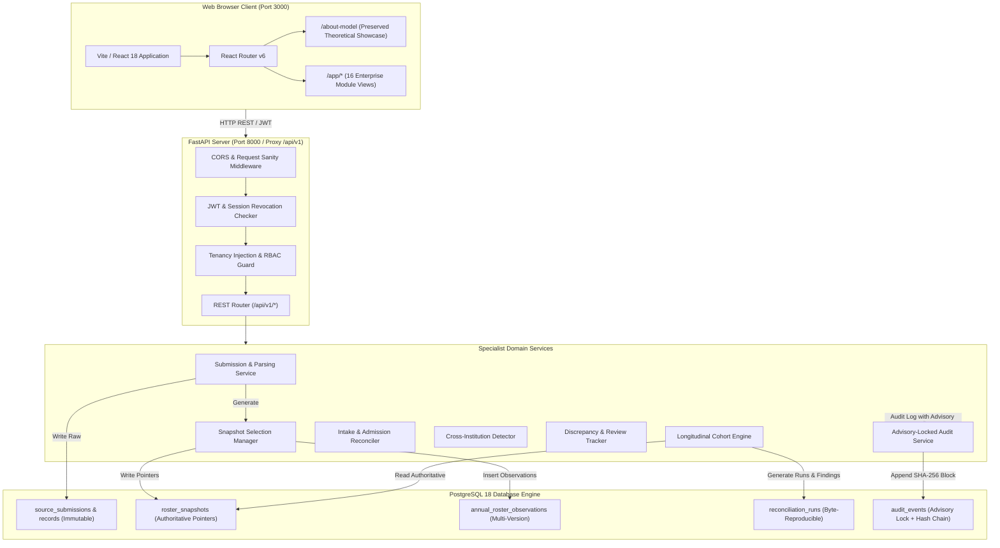
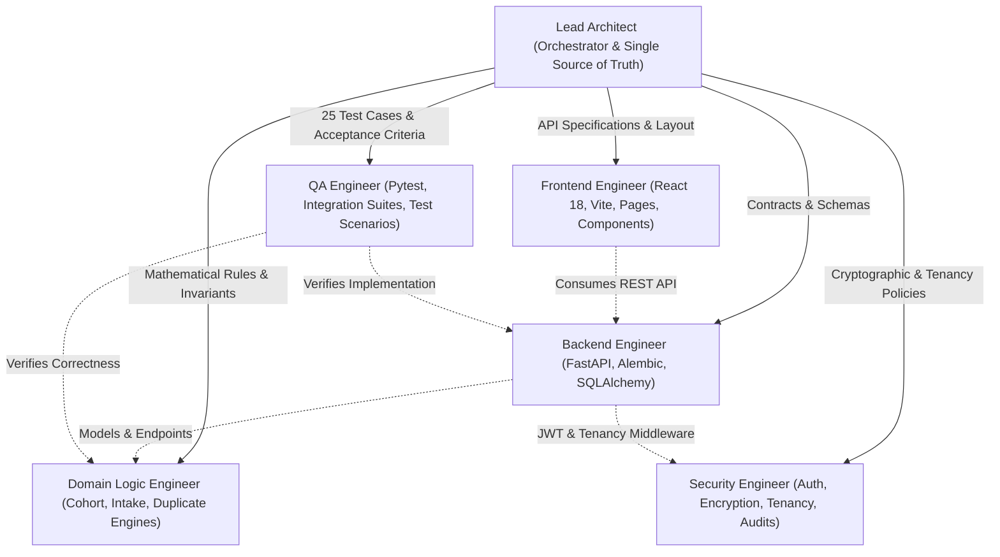

# APAAR SETU — System Architecture Specification

**Document Version:** 1.1.0  
**Status:** Approved Architecture Draft  
**Target Platform:** Full-Stack Enterprise Web Application (Vite/React + FastAPI/PostgreSQL)  

---

## 1. Architectural Blueprint & Repository Topology

To prevent unnecessary refactoring and preserve existing working functionality, the repository topology retains the frontend at the repository root and encapsulates backend services within `/backend`:

```
c:\Users\moham\OneDrive\Desktop\SIH26\26263\
├── .gitignore
├── index.html                     # Vite application entry point
├── package.json                   # Frontend dependencies (React 18, Vite 5, TS 5)
├── PRD.md                         # Authoritative product requirements
├── DATABASE_SCHEMA.md             # Canonical database schema & DDL
├── SYSTEM_ARCHITECTURE.md         # System architecture & deployment blueprint
├── DOMAIN_RULES.md                # Domain algorithms & statutory rules
├── SECURITY_MODEL.md              # Cryptographic, auth, & tenancy specifications
├── API_CONTRACTS.md               # OpenAPI 3.1 contract specifications
├── vite.config.ts                 # Vite config (dev server port 3000, API proxy to 8000)
├── src/                           # Frontend React application
│   ├── main.tsx                   # React root mount
│   ├── App.tsx                    # Top-level routing & layout router
│   ├── components/                # Reusable UI components & preserved model showcase
│   │   ├── FourLayerModel.tsx     # Preserved conceptual showcase
│   │   ├── ProofChainSection.tsx  # Preserved conceptual showcase
│   │   ├── PolicyAwareReconciliation.tsx
│   │   ├── IdentityReconciliation.tsx
│   │   ├── PrivacyResponsibleVerification.tsx
│   │   └── ...
│   ├── pages/                     # 16 Enterprise functional modules
│   ├── layouts/                   # Sidebar, Topbar, Tenant Selector
│   ├── services/                  # Axios API clients & TanStack Query hooks
│   └── types/                     # TypeScript domain interfaces
└── backend/                       # Python FastAPI Backend
    ├── requirements.txt           # fastapi, sqlalchemy, alembic, psycopg2-binary, argon2-cffi, etc.
    ├── alembic.ini                # Migration configuration
    ├── alembic/                   # Schema migrations
    │   └── versions/              # Versioned migration scripts
    ├── app/
    │   ├── main.py                # FastAPI factory & middleware configuration
    │   ├── core/                  # Security, config, tenancy & database session
    │   │   ├── config.py          # Pydantic Settings (.env management)
    │   │   ├── database.py        # SQLAlchemy 2.0 Async/Sync engine
    │   │   ├── security.py        # Argon2id, AES-256-GCM, HMAC blind index, JWT
    │   │   └── permissions.py     # Role & Tenancy enforcement dependencies
    │   ├── models/                # SQLAlchemy 2.0 declarative models (22 entities)
    │   ├── schemas/               # Pydantic v2 validation contracts
    │   ├── api/                   # Versioned REST controllers (/api/v1)
    │   │   ├── v1/
    │   │   │   ├── auth.py
    │   │   │   ├── institutions.py
    │   │   │   ├── programmes.py
    │   │   │   ├── students.py
    │   │   │   ├── submissions.py
    │   │   │   ├── validation.py
    │   │   │   ├── admission.py
    │   │   │   ├── duplicate_detection.py
    │   │   │   ├── cohort.py
    │   │   │   ├── reconciliation.py
    │   │   │   ├── discrepancies.py
    │   │   │   ├── reviews.py
    │   │   │   ├── verification.py
    │   │   │   ├── reports.py
    │   │   │   ├── rules.py
    │   │   │   └── audit.py
    │   ├── services/              # Pure domain logic & orchestration engines
    │   │   ├── cohort_engine.py   # Longitudinal Cohort Integrity Engine
    │   │   ├── admission_engine.py# Statutory intake compliance evaluator
    │   │   ├── duplicate_engine.py# Cross-institution overlap detector
    │   │   ├── apaar_validator.py # Documented format validator (no fake checksums)
    │   │   ├── snapshot_service.py# Authoritative snapshot manager
    │   │   └── audit_service.py   # Advisory-locked append-only ledger
    │   └── repositories/          # Tenancy-scoped DB access layer
    └── tests/                     # Pytest suite (covering all 25 PRD test cases)
```

---

## 2. Component Architecture & Data Flow



---

## 3. Core Lifecycle Workflows

### 3.1 Three-Phase Ingestion Architecture & Finite State Machine

To enforce zero-leakage previewing, non-destructive versioning, and atomic rollbacks, data ingestion is strictly divided into three distinct operational phases:

1. **Operation A — Upload & Fingerprinting:**
   - Client sends file stream and context parameters.
   - Server computes incoming file SHA-256 fingerprint while streaming.
   - Evaluates database-enforced idempotency key and contextual duplicate constraints.
   - Stores raw byte stream securely in `backend/uploads/<storage_key>`.
   - Inspects headers and sample rows; suggests default column mappings.
   - Transitions: `None` $\to$ `UPLOADED` $\to$ `VALIDATING`.
   
2. **Operation B — Full Mapping Preview & Immutable Version Binding:**
   - Server processes the *complete* file using proposed column mappings.
   - Computes full-file validation errors, warnings, and duplicate counts.
   - **Zero Database Pollution:** Absolutely no student identities, institutional records, or roster observations are written or mutated during preview.
   - **Immutable Preview Version Creation:** Creates a persistent `submission_previews` record capturing `preview_id`, `submission_id`, `file_fingerprint`, `column_mapping`, `mapping_version`, `mapping_hash` (SHA-256 of canonical mapping JSON), and `validation_summary`.
   - Transitions: `VALIDATING` $\to$ `PREVIEW_READY` (or `VALIDATION_FAILED` if limits/format violated).
   
3. **Operation C — Atomic Transactional Confirmation:**
   - Triggered only by explicit client confirmation referencing a valid `preview_id`.
   - **Pre-Ingestion Revalidation:** The backend validates:
     - The referenced `preview_id` exists, is active, and matches `submission.id`.
     - The stored raw file fingerprint matches the preview's `file_fingerprint`.
     - The supplied column mapping matches `preview.mapping_hash` identically.
     - Stale previews or modified mappings are rejected with `409 Conflict`; modified mappings require generating a new preview.
   - Re-validates the stored original file against the confirmed mapping before execution.
   - Executes atomic SQL transaction: locks submission row (`SELECT ... FOR UPDATE`), creates immutable `source_submission_records`, resolves global identities (concurrency-safe), binds institutional records, appends versioned `annual_roster_observations` (with dual composite FKs enforcing context and record integrity), and generates `roster_snapshots`.
   - Transitions: `PREVIEW_READY` $\to$ `INGESTING` $\to$ `COMMITTED`.

```mermaid
stateDiagram-v2
    [*] --> UPLOADED: File Stream Received & Fingerprinted
    UPLOADED --> VALIDATING: Full-File Verification Begins
    VALIDATING --> PREVIEW_READY: Headers, Rows & Mappings Scanned
    VALIDATING --> VALIDATION_FAILED: Limit Exceeded / Unparseable Archive
    
    PREVIEW_READY --> CANCELLED: Admin Discards Upload (Evidence Preserved)
    PREVIEW_READY --> INGESTING: Admin Confirms Import (/confirm)
    
    INGESTING --> COMMITTED: Transaction Committed (Records & Snapshot Written)
    INGESTING --> FAILED: Ingestion Error (Transaction Rolled Back 100%; Status Logged in Isolated Tx)
    
    COMMITTED --> [*]
    CANCELLED --> [*]
    VALIDATION_FAILED --> [*]
    FAILED --> [*]
```



#### Correct Transaction Failure Handling Pattern:
When an error occurs during ingestion confirmation, the system strictly follows a dual-transaction pattern to guarantee database cleanliness:
1. **Begin Ingestion Transaction:** Acquire row lock on submission (`SELECT ... FOR UPDATE`).
2. **Execute Ingestion Writes:** Perform identity resolution, record bindings, observation appends, and snapshot creation.
3. **Success Path:** Mark submission `COMMITTED`, commit transaction.
4. **Failure Path:** 
   - Immediately issue `ROLLBACK` on the entire ingestion transaction. All student identities, records, and observations created during the failed attempt are completely erased.
   - In a **separate, isolated database transaction**, update `source_submissions` setting `submission_status = 'FAILED'` and recording a sanitized `failure_reason`.
   - This ensures the failure-reporting mechanism cannot accidentally preserve partial student records or observations.

---

### 3.2 Snapshot Model: Decoupled Completeness, Lifecycle & Concurrency

Authoritative selection denotes regulatory validity, not completeness:

1. **Completeness Dimension:**
   - `COMPLETE`: Full student cohort for the academic year is reported.
   - `PARTIAL`: Partial reporting (e.g., supplementary batch or single branch).
   - `UNKNOWN`: Unverified or unclassified completeness.
   
2. **Lifecycle Dimension:**
   - `ACTIVE`: The valid, operating snapshot for this academic year. An authoritative snapshot **must** have `lifecycle_status = 'ACTIVE'`.
   - `SUPERSEDED`: Replaced by a more recent or corrected submission snapshot. A `SUPERSEDED` snapshot **must** have `is_authoritative = FALSE`.
   - Enforced by DB constraint: `CONSTRAINT chk_authoritative_lifecycle CHECK (NOT (is_authoritative = TRUE AND lifecycle_status = 'SUPERSEDED'))`.

3. **Concurrency Serialization & Atomic Promotion Authorization:**
   - Before executing promotion, the engine enforces strict pre-flight authorization:
     - Acquires the transaction-level advisory lock:
       `SELECT pg_advisory_xact_lock(hashtext('snap_' || institution_id::text || '_' || programme_id::text || '_' || academic_year));`
     - Verifies caller tenancy authorization (an Institution Admin can only promote snapshots within their assigned institution).
     - Verifies target snapshot context matches target `(institution_id, programme_id, academic_year)`.
     - Verifies target snapshot is eligible for promotion (`lifecycle_status = 'ACTIVE'`, and its source submission is `COMMITTED`).
   - Atomically within the same transaction:
     - Demotes previous authoritative snapshot: `is_authoritative = FALSE, lifecycle_status = 'SUPERSEDED', superseded_by_snapshot_id = :id, superseded_at = NOW()`.
     - Promotes target snapshot: `is_authoritative = TRUE, lifecycle_status = 'ACTIVE'`.
   - If any step fails, the transaction is rolled back, leaving the previous authoritative snapshot completely unchanged.
   - The partial unique index `idx_uq_authoritative_snapshot` serves as a final database-enforced safeguard.

4. **Snapshot Canonicalization Version `v1-sha256-sorted-uuids`:**
   - Extracts internal student UUIDs (`internal_student_uuid`) for all observed students in the snapshot.
   - Filters to a distinct set and sorts lexicographically.
   - Serializes into canonical UTF-8 JSON array: `["0192e2b3...", "0192e2b4...", ...]`.
   - Computes SHA-256 digest. **Plaintext APAAR identifiers are never included in snapshot hashes.**
   - **Headcount Definitions:**
     - `declared_headcount`: Total student count declared in the submission header or import dialog.
     - `observed_headcount`: Distinct count of valid student records successfully ingested into the snapshot.

---

### 3.3 Database-Enforced Idempotency & Concurrency Protections

1. **Tenant-Scoped Idempotency Rule (`Idempotency-Key`):**
   - Database uniqueness: `CREATE UNIQUE INDEX uq_source_submissions_tenant_idempotency ON source_submissions(institution_id, client_idempotency_key) WHERE client_idempotency_key IS NOT NULL;`.
   - **Incoming Request Evaluation:**
     - Computes the incoming file SHA-256 fingerprint *before* evaluating replay logic.
     - **Same Key + Same Request** (matching context & file fingerprint): Returns original submission/preview payload.
     - **Same Key + Different Request** (differing file or context parameters): Returns `409 Conflict` ("Idempotency key reused with conflicting request payload").
     - **Different Key + Identical File in Same Context:** Detected via `uq_submission_context_fingerprint`; prevents duplicate committed observations.
     - **Same File in Different Programme or Year:** Permitted as an independent valid submission.

2. **Retry-Safe Contextual File Deduplication:**
   - Enforced via partial unique index:
     ```sql
     CREATE UNIQUE INDEX uq_active_context_fingerprint 
     ON source_submissions (institution_id, programme_id, academic_year, submission_type, file_fingerprint) 
     WHERE submission_status NOT IN ('FAILED', 'CANCELLED');
     ```
   - **Active or Committed Deduplication:** Prevents duplicate uploads while a submission is in progress (`UPLOADED`, `VALIDATING`, `PREVIEW_READY`, `INGESTING`) or already `COMMITTED`.
   - **Clean Retries Permitted:** If a previous submission failed (`FAILED`) or was discarded (`CANCELLED`), an administrator can upload the identical file again. The previous failed/cancelled submission record remains permanently preserved in the ledger for full auditability.
   - **Different Contexts Permitted:** Uploading the same file for a different academic year or programme is accepted cleanly.

3. **Global Identity Concurrency Protection:**
   - Database uniqueness: `CREATE UNIQUE INDEX uq_student_identities_apaar_blind_index ON student_identities(apaar_blind_index) WHERE apaar_blind_index IS NOT NULL;`.
   - If two concurrent submissions contain the same APAAR identifier:
     - The first transaction creates the `StudentIdentity`.
     - The second transaction catches the uniqueness conflict on `apaar_blind_index`, retrieves the existing global identity, and safely binds its institutional record.
     - Zero duplicate global identities are created. Weak attributes (identical student names) never trigger automatic identity merges.

4. **Complete Annual Observation Context Integrity:**
   - `annual_roster_observations` enforces **dual composite foreign keys**:
     1. Contextual Binding: `(source_submission_id, institution_id, programme_id, academic_year) REFERENCES source_submissions(id, institution_id, programme_id, academic_year)`. An observation can never reference a submission from a different institution, programme, or academic year.
     2. Record-Level Binding: `(source_record_id, source_submission_id) REFERENCES source_submission_records(id, submission_id)`. An observation can never reference a parsed row belonging to another submission.

---

### 3.4 Raw Evidence Preservation, Dual XLSX Inspection & Parser Hardening

1. **Verbatim Raw Evidence Preservation:**
   - Raw cell values are preserved verbatim in `source_submission_records.raw_payload`. Cells are **never** prefixed with apostrophes or mutated in the database evidence.
   - Formula execution is disabled; formula strings and cached values are parsed and recorded in `formula_metadata`.
   - Formula injection defenses (e.g. prefixing `'=`, `'+`, `'-`, `'@`) are applied strictly during export generation (CSV/XLSX download) or rendering in interactive contexts, never mutating stored database evidence.

2. **Dual XLSX Inspection & Missing Cached Values:**
   - XLSX files are inspected twice:
     - Pass 1 (`data_only=False`): Captures formula strings verbatim (e.g. `=SUM(A1:A5)`).
     - Pass 2 (`data_only=True`): Extracts pre-calculated cached values.
   - **Missing Cached Formula Value Handling:** If a formula has no cached evaluation result (e.g. generated by a third-party tool without Excel evaluation), the parser marks the cell with a validation warning (`UNRESOLVED_FORMULA_NO_CACHED_VALUE`) and treats the value as unparseable/missing rather than executing arbitrary formulas or guessing.

3. **Configurable Limits & Content Validation:**
   - Limits are centrally configured via environment settings:
     - `MAX_UPLOAD_SIZE_BYTES`: $10\text{ MB}$ (default).
     - `MAX_UNCOMPRESSED_ARCHIVE_BYTES`: $50\text{ MB}$ (default).
     - `MAX_ARCHIVE_ENTRY_COUNT`: $500$ entries (default).
     - `MAX_COMPRESSION_RATIO`: $20:1$ (default, defeats Zip Bombs).
     - `MAX_ROW_COUNT`: $25,000$ rows (default).
     - `MAX_COL_COUNT`: $50$ columns (default).
     - `PARSER_TIMEOUT_SECONDS`: $30$ seconds (default).
   - **MIME & Magic Bytes Content Validation:** File content is verified using file signature magic bytes (ZIP header `PK\x03\x04` for XLSX, valid ASCII/UTF-8 character stream for CSV) in addition to MIME headers.
   - XML parsing uses `defusedxml` to prevent billion-laughs and external entity attacks.

4. **Original Evidence Retention on Cancellation:**
   - When a submission is marked `CANCELLED`, its database row remains in the submission ledger with `cancelled_at` and `cancelled_by_user_id`.
   - The original uploaded file is permanently retained in `backend/uploads/<storage_key>` outside the web root with restrictive filesystem permissions (0600), preserving audit provenance.
   - Temporary parser cache artifacts are cleaned up, and any subsequent confirmation attempt on a cancelled submission is rejected.

---

### 3.5 Longitudinal Cohort Integrity Flow
1. **Snapshot Resolution:** Engine retrieves the authoritative base snapshot $S_t$ and target snapshot $S_{t+1}$ using their `roster_snapshots.id`.
2. **Completeness Gate:**
   - If $S_t.\text{completeness\_status} \in \{\text{PARTIAL}, \text{UNKNOWN}\}$, the engine suppresses `UNEXPLAINED_DISAPPEARANCE` generation for students not appearing in $S_{t+1}$, instead marking them as `UNCERTAIN_HISTORICAL_BASELINE`.
3. **Set Execution & Match Reconciliation:**
   - Computes intersections, queries documented transfer events, late admissions, and withdrawals.
4. **Reproducibility Recording:**
   - Captures `engine_version`, `algorithm_version`, `configuration_snapshot`, `source_snapshot_ids`, `rule_version_ids`, `identity_resolution_decisions`, and `canonical_serialization_version`.
   - Produces `reconciliation_findings` linked to the run.

---

## 4. Multi-Agent Development & Operational Boundaries

To prevent file collision and maintain architectural integrity, five specialist engineering subagents operate under the Lead Architect's orchestration:



### Delegation Rules:
- **Contract Freezing:** Database schemas (`DATABASE_SCHEMA.md`) and API specifications (`API_CONTRACTS.md`) are frozen by the Lead Architect. No agent alters schemas unilaterally.
- **Isolated Logic:** Domain algorithms in `backend/app/services/` are implemented as pure, deterministic Python functions with zero coupling to HTTP request objects, enabling independent unit testing.
- **Isolated Branching:** Independent tasks are developed in isolated git branches / worktrees and merged only after passing full QA and security review.

